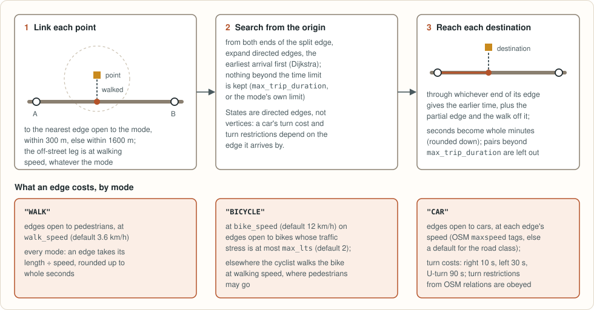
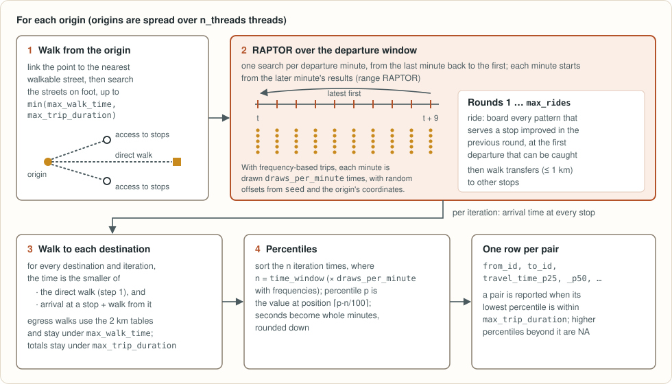
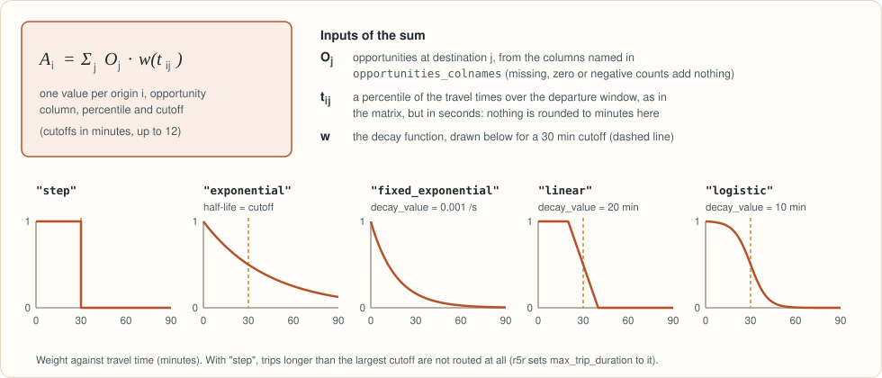
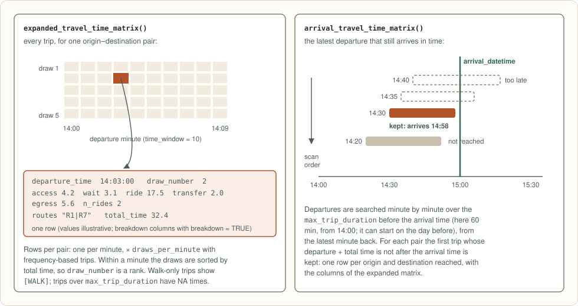

<h1 align="center"></h1>

<p align="center">
<a href="https://github.com/StrategicProjects/peabiru-routing/actions/workflows/ci.yml"></a>
<a href="LICENSE-MIT"></a>
<a href="https://lifecycle.r-lib.org/articles/stages.html#experimental"></a>
<a href="crates/peabiru-core"></a>
<a href="python"></a>
<a href="r">= 4.2"></a>
<a href="js"></a>
<a href="https://crates.io/crates/peabiru-core"></a>
<a href="https://docs.rs/peabiru-core"></a>
<a href="https://doi.org/10.5281/zenodo.24125477"></a>
<!-- After the first release on each remaining registry, uncomment the matching badge:
<a href="https://pypi.org/project/peabiru/"></a>
<a href="https://CRAN.R-project.org/package=peabiru"></a>
<a href="https://www.npmjs.com/package/peabiru"></a>
-->
</p>

A multimodal routing engine written in Rust, for R, Python, JavaScript, Rust
and the shell. It builds a network in memory from an OpenStreetMap extract and GTFS
feeds and computes travel-time matrices and accessibility by walking,
cycling, driving and public transport. It needs no Java runtime, keeps
nothing on disk, and the network is built once and shared by every query
and thread.

| Package | For | Directory | Registry |
|---|---|---|---|
| `peabiru` | R | [`r/`](r) (extendr) | CRAN, not published yet |
| `peabiru` | Python | [`python/`](python) (PyO3, maturin) | PyPI, not published yet |
| `peabiru` | JavaScript (browsers, Node) | [`js/`](js) (WebAssembly, wasm-bindgen) | npm, not published yet |
| `peabiru-core` | Rust | [`crates/peabiru-core`](crates/peabiru-core) | [crates.io](https://crates.io/crates/peabiru-core) |
| `peabiru` | command line | [`crates/peabiru-cli`](crates/peabiru-cli) | |

The name comes from the Peabiru, the pre-Columbian network of trails that
crossed South America from the Atlantic to the Andes.


## What it computes

- **Travel-time matrices** between any number of origins and destinations:
  on foot, by bicycle and by car on the street network, and by walking plus
  public transport over a departure window, with percentiles of the travel
  time across the window.
- **Accessibility**: the opportunities reachable from each origin, with
  step, exponential, fixed exponential, linear and logistic decay functions
  and several cutoffs at once.
- **Expanded matrices**: the travel time of every departure minute, with the
  routes, the waiting, riding and transfer times of each trip.
- **Arrival-time matrices**: the latest trips that arrive by a given time.
- **Isochrones**: the area reached within each cutoff, as polygons traced
  from a travel-time surface or as the street segments reached.

Not implemented yet: detailed itineraries, public transport
reached by bicycle or car, subsets of transit modes, fares, scenarios and
elevation. Asking for any of them is an error; nothing is silently ignored.

**Status:** version 0.0.1, early development. The interfaces may still
change.

## How it works

**Building the network.** One `.pbf` becomes a street network with one edge
per direction, the modes allowed on it, car speeds and the cyclists' level of
traffic stress; the GTFS feeds become patterns of trips, each stop is linked
to the nearest walkable street, and walking tables for transfers and egress
are computed once.


**Street routing.** Each point is linked to the nearest street open to the
mode, and a search over directed edges, cheapest first, runs from every
origin up to the time limit, with walking and cycling speeds, traffic stress,
car speeds, turn costs and turn restrictions.



**Public transport.** For each origin, a walk reaches the nearby stops; RAPTOR
then runs for every minute of the departure window, from the last minute back
to the first so that each minute reuses the later one's results, with Monte
Carlo draws for frequency-based trips; a walk from the stops reaches each
destination, and the times of all the iterations are summarised as
percentiles.



<details>
<summary><b>Accessibility</b>: opportunities weighted by a decay function of the travel time</summary>



</details>

<details>
<summary><b>Expanded and arrival matrices</b>: every departure minute, and the latest trip that arrives in time</summary>



</details>

## Example

In R:

```r
library(peabiru)

data_path <- system.file("extdata/spo", package = "peabiru")
network <- build_network(data_path)
points <- read.csv(file.path(data_path, "spo_points.csv"))

ttm <- travel_time_matrix(
  network, points, points,
  mode = c("WALK", "TRANSIT"),
  departure_datetime = as.POSIXct("2019-05-13 14:00:00", tz = "America/Sao_Paulo"),
  percentiles = c(25, 50, 75),
  seed = 42
)
```

In Python:

```python
import datetime as dt
import peabiru

network = peabiru.build_network(peabiru.sample_data_path())
points = peabiru.sample_points()

ttm = peabiru.travel_time_matrix(
    network, points, points,
    mode=["WALK", "TRANSIT"],
    departure_datetime=dt.datetime(2019, 5, 13, 14, 0),
    percentiles=[25, 50, 75],
    seed=42,
)
```

In JavaScript (Node; in a browser, the bytes come from `fetch()`):

<!-- example: site/js/examples/landing.mjs:landing (checked by site/js/run_examples.mjs) -->
```js
// Not on npm yet. From a clone of the repository (needs Rust and wasm-pack):
//   cd js && sh build.sh, then npm install /path/to/peabiru-routing/js
import { readFile } from "node:fs/promises";
import * as peabiru from "peabiru";

// the sample network of the Python package (python/peabiru/data/spo)
const network = await peabiru.buildNetwork({
  pbf: await readFile("spo_osm.pbf"),
  gtfs: [{ name: "spo_gtfs.zip", data: await readFile("spo_gtfs.zip") }],
});
const points = {
  id: ["a", "b", "c"],
  lon: [-46.6290, -46.6321, -46.6355],
  lat: [-23.5563, -23.5577, -23.5601],
};

const ttm = await peabiru.travelTimeMatrix(network, points, points, {
  mode: ["WALK", "TRANSIT"],
  departureDatetime: "2019-05-13 14:00:00",
  percentiles: [25, 50, 75],
  seed: 42,
});
```

All three use the small network of São Paulo that ships with the R and
Python packages. More in the README of each package ([R](r/README.md),
[Python](python/README.md), [JavaScript](js/README.md),
[Rust](crates/peabiru-core/README.md)) and in the documentation sites, built
by [`site/build.sh`](site/README.md).

## Installing from source

Nothing is published yet. From a clone, with Rust (rustc 1.81 or later):

```sh
R CMD INSTALL r                                     # R package
cd python && maturin develop --uv --release         # Python package
cd js && sh build.sh                                # JavaScript package (needs wasm-pack)
cargo build --release -p peabiru-cli                # command-line tool
```

## Compatibility with r5r

The functions of the R and Python packages have the names, arguments and
defaults of [r5r](https://github.com/ipea/r5r) 2.5.0 (in camelCase in the
JavaScript package), so code written for
r5r needs few changes, and they return the same values: the engine is a port
of Conveyal's [R5](https://github.com/conveyal/r5) 7.6, the engine r5r
drives. [`bench/`](bench) runs the same requests on both and compares the
outputs pair by pair on r5r's sample networks of Porto Alegre and São Paulo;
the comparisons are exact.

## Development

```sh
cargo test                                          # core and command-line tool
cd python && maturin develop --uv && .venv/bin/python -m pytest
Rscript -e 'devtools::test("r")'
cd js && sh build.sh && node --test tests/*.test.mjs
node site/js/run_examples.mjs                       # the examples of the JavaScript guide
site/build.sh                                       # documentation sites, into _site/
```

## Licence and credits

peabiru is distributed under the MIT licence ([`LICENSE-MIT`](LICENSE-MIT)).
To cite it, see [`CITATION.cff`](CITATION.cff).

Its routing logic is ported from R5 (MIT, © Conveyal) and its interface comes
from r5r, developed at Ipea. Two source files are translations of parts of
Apache Commons Math 3 (Apache-2.0). The notices and licence texts of these
works are in [`LICENSE-THIRD-PARTY`](LICENSE-THIRD-PARTY), which is
distributed with every package. The sample network in the R and Python
packages contains map data © OpenStreetMap contributors, under the
[Open Database License](https://www.openstreetmap.org/copyright).

The Python extension module, the R package's library, the WebAssembly module
of the JavaScript package and the command-line tool also contain code from
other Rust crates (pyo3, extendr, miniz_oxide and
others, under MIT, Apache-2.0 and similar licences). Their licences are in a
`LICENSE-RUST-CRATES` file shipped with each of those packages, generated
from the lockfiles by `tools/third_party_notices.py`.
