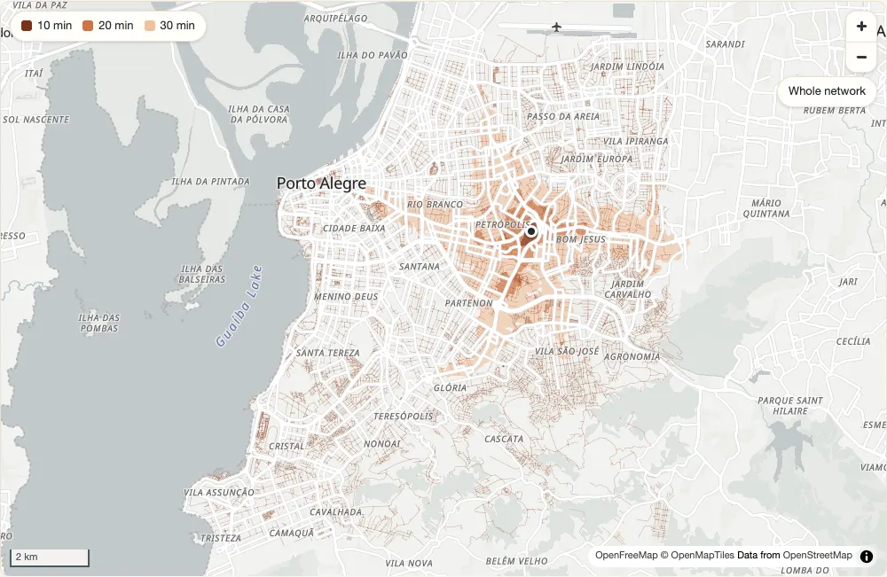

# peabiru (JavaScript)

Multimodal routing on [OpenStreetMap](https://www.openstreetmap.org) street
networks and [GTFS](https://gtfs.org) public transport, in WebAssembly:
travel-time matrices, accessibility, minute-by-minute (expanded) and
arrival-time matrices, detailed itineraries, fares and Pareto frontiers,
and isochrones, by walking, cycling, driving and public transport, with
slope costs from an elevation raster and scenarios of car speeds and
traffic stress.

The routing engine is the Rust core of the peabiru packages for R and
Python, compiled to WebAssembly. It runs in browsers, in bundlers and in
Node (18 or later), with no server and no Java, and gives the same numbers
as the native packages.

**Status**: early development; the interfaces may still change.

[](https://github.com/StrategicProjects/peabiru-routing/tree/main/site/demo)

Try it: the [isochrone demo](https://github.com/StrategicProjects/peabiru-routing/tree/main/site/demo) builds a network and routes in the
page, with this package and no server ([how it works](https://github.com/StrategicProjects/peabiru-routing/blob/main/site/js/src/examples.md)).

```sh
npm install peabiru
```

```js
import { readFile } from "node:fs/promises";
import * as peabiru from "peabiru";

const network = await peabiru.buildNetwork({
  pbf: await readFile("spo_osm.pbf"),
  gtfs: [{ name: "spo_gtfs.zip", data: await readFile("spo_gtfs.zip") }],
});

const points = {
  id: ["a", "b", "c"],
  lon: [-46.6290, -46.6321, -46.6355],
  lat: [-23.5563, -23.5577, -23.5601],
};

const ttm = await peabiru.travelTimeMatrix(network, points, points, {
  mode: ["WALK", "TRANSIT"],
  departureDatetime: "2019-05-13 14:00:00",
  percentiles: [25, 50, 75],
  seed: 42,
});
// ttm.from_id, ttm.to_id: string arrays; ttm.travel_time_p25, ...: Int32Array

network.free();
```

In a browser, read the files with `fetch(url).then((r) => r.arrayBuffer())`
or from an `<input type="file">` (`file.arrayBuffer()`).

Every function that reads or routes on a network returns a Promise. To
route on several threads, build the network with workers:
`buildNetwork({ pbf, gtfs, nThreads: 4 })` (see [Threads](#threads)).

| Function | What it computes |
|---|---|
| `buildNetwork({ pbf, gtfs, tif, elevation, nThreads })` | a network from an OpenStreetMap extract, any GTFS feeds and an optional elevation raster |
| `travelTimeMatrix(network, origins, destinations, options)` | travel times between every origin and destination |
| `accessibility(network, origins, destinations, options)` | cumulative or decay-weighted access to opportunities |
| `expandedTravelTimeMatrix(network, origins, destinations, options)` | travel times minute by minute, with a breakdown of each trip |
| `arrivalTravelTimeMatrix(network, origins, destinations, options)` | the latest trip that arrives by a given time |
| `detailedItineraries(network, origins, destinations, options)` | the legs of the fastest trip, or of the alternatives, as GeoJSON |
| `isochrone(network, origins, options)` | the areas (or street segments) reached within each cutoff, as GeoJSON |
| `setupFareStructure(network, baseFare, options)`, `readFareStructure(bytes)`, `writeFareStructure(fs)` | a fare structure, made, read from or written to the bytes of a `.zip` file |
| `paretoFrontier(network, origins, destinations, options)` | the travel time at each fare cutoff |
| `findSnap(network, points, options)` | where points snap to the streets |
| `streetNetworkBbox(network, output)` | the bounding box of the street network |
| `streetNetworkToSf(network)`, `transitNetworkToSf(network)` | the street and public transport networks as GeoJSON |
| `checkTransitAvailability(network, options)` | the services active on dates |
| `getGtfsErrors(gtfs)` | the errors gtfs-lib reports in GTFS feeds |
| `coreVersion()`, `version` | versions of the Rust core and of this package |

`network.info()` gives the sizes of a network, `await network.transitAvailability(date)`
the services running on a date, `network.workers` its number of workers, and `network.free()`
releases its memory and stops its workers (a network lives in the
WebAssembly module's memory, or in its workers' memory, until then).

The full types are in `lib/index.d.ts`.

## Arguments

The functions have the arguments and defaults of the Python and R
packages, in camelCase and in an options object: `departure_datetime`
is `departureDatetime`, `max_trip_duration` is `maxTripDuration`, and so on
(`timeWindow`, `percentiles`, `maxWalkTime`, `maxBikeTime`, `maxCarTime`,
`walkSpeed`, `bikeSpeed`, `maxRides`, `maxLts`, `drawsPerMinute`, `seed`,
`opportunitiesColnames`, `decayFunction`, `cutoffs`, `decayValue`,
`breakdown`, `arrivalDatetime`, `fareStructure`, `newCarspeeds`, ...;
`paretoFrontier()` routes on foot and by public transport by default).
An option name that is not one of them is an error. Each options object
also takes `onWarning`, a function that receives the warnings of the call
(by default `console.warn`).

- **Points** are columns `{ id, lon, lat }` (arrays or typed arrays) or an
  array of `{ id, lon, lat }` objects. For `accessibility()` the
  destinations also hold the opportunity columns. Ids that are not strings
  are converted with `String()`, with a warning; points with missing
  coordinates are not routed, with a warning; duplicated ids are an error.
- **Dates and times** are strings `"YYYY-MM-DD HH:MM:SS"` (or with `T`, or
  without seconds), taken as they read: the clock time of the GTFS feeds.
  A `Date` also works, and is read in the local time zone of the
  JavaScript runtime, which is rarely the feeds' time zone: prefer strings.
- **Frequency-based GTFS** (`frequencies.txt`) is routed with Monte Carlo
  draws: results are reproducible only with a `seed`.
  Without one, a random seed is drawn for each call.
- `nThreads` of a routing call is the number of the network's workers it
  uses (null, the default, or `Infinity`: all of them; more than the
  network has: all it has; a network without workers ignores it). It must
  be 1 or more: 0 is an error.
- `signal` takes an `AbortSignal` to stop a call (see [Threads](#threads)).
- `verbose` and `progress` are checked; peabiru prints nothing.

## Results

Results are objects of columns, never arrays of
row objects (a matrix can have millions of rows):

- `travelTimeMatrix()`: `from_id`, `to_id` (arrays of strings) and one
  `Int32Array` `travel_time_pXX` per percentile (`travel_time_p05`, ...),
  in whole minutes;
- `accessibility()`: `id`, `opportunity` (strings), `percentile`, `cutoff`
  (`Int32Array`; no `cutoff` with `"fixed_exponential"`) and
  `accessibility` (`Float64Array`), one row per origin, opportunity,
  percentile and cutoff;
- `expandedTravelTimeMatrix()` and `arrivalTravelTimeMatrix()`: `from_id`,
  `to_id`, `departure_time` (`"HH:MM:SS"`), `draw_number`, with
  `breakdown: true` the times `access_time`, `wait_time`, `ride_time`,
  `transfer_time`, `egress_time` (`Float64Array`, minutes), then `routes`
  (strings), `n_rides` (with `breakdown`) and `total_time`;
- `paretoFrontier()`: `from_id`, `to_id`, `percentile`, `travel_time`
  (`Int32Array`) and `monetary_cost` (`Float64Array`);
- `findSnap()`, `checkTransitAvailability()` and `getGtfsErrors()`: their
  columns, in the same way.

`detailedItineraries()` returns a GeoJSON `FeatureCollection` of
`LineString`s, one per leg, with the columns as properties (or, with
`dropGeometry: true`, an array of those rows), and `streetNetworkToSf()`
and `transitNetworkToSf()` GeoJSON `FeatureCollection`s of their two
tables.

`isochrone()` returns a GeoJSON `FeatureCollection` (coordinates
`[lon, lat]`, WGS 84). With
`polygonOutput: true` (the default): one feature per origin, percentile
and cutoff, with properties `id`, `isochrone` (the cutoff) and
`percentile` (`"p50"`) and a `MultiPolygon` (empty when nothing is
reached). With `polygonOutput: false`: one feature per street segment
reached, with properties (`id`, `edge_index`, `osm_id`,
`isochrone`, `travel_time_p50`, `from_vertex`, `to_vertex`,
`street_class`, `length`, `walk`, `car`, `car_speed`, `bicycle`,
`bicycle_lts`) and a `LineString`. The polygons are the rings the contouring gives (a port of isoband), not
repaired and not snapped to a grid: the rings of one polygon may touch at
a vertex. The order of the rings and the vertex each starts at are the
same wherever the package runs; the native packages follow their platform
(another order on Linux and Windows). Their
coordinates can differ from the native packages' in the last digits
(about 1e-14 degrees), because WebAssembly has its own `sinh` and `atan`;
the line isochrones are identical.

Missing values are `peabiru.NA_INT32` (-2147483648) in the `Int32Array`
columns, `NaN` in the `Float64Array` columns and `null` in the string
columns. Rows are origin-major, in the order of the inputs; pairs that are
not reached are left out.

To walk through the rows of a result:

```js
for (let i = 0; i < ttm.from_id.length; i++) {
  const t = ttm.travel_time_p50[i];
  if (t !== peabiru.NA_INT32) console.log(ttm.from_id[i], ttm.to_id[i], t);
}
```

## What peabiru refuses

What peabiru does not do throws `peabiru.UnsupportedError`; it is never
silently ignored: `outputDir` (there is no file system to write to),
expanded and arrival matrices by a street mode alone, and R5's own fare
calculators (a `fareStructure` with a `type`). A GTFS feed with errors of
priority `HIGH` is refused by `buildNetwork()`
(`getGtfsErrors()` lists them).

## Elevation

`buildNetwork({pbf,
gtfs, tif})` gives walking and cycling times slope costs from an elevation
raster: `elevation: "TOBLER"` (the default), `"MINETTI"` or `"NONE"`.
The raster is a GeoTIFF of one band in WGS 84 longitude and latitude
(EPSG:4326) or another coordinate reference system whose transform peabiru
reproduces exactly: SIRGAS 2000 (4674), SAD69 (4618), Corrego Alegre 1970-72
(4225), their UTM zones used in Brazil (31965-31985, 6210, 6211, 5396;
29168-29172, 29187-29195; 22521-22525), SIRGAS 2000 / Brazil Polyconic
(5880), WGS 84 / UTM (32601-32660, 32701-32760) and WGS 84 / Pseudo-Mercator
(3857), north up, uncompressed or compressed with LZW, Deflate or PackBits;
other rasters are an error. peabiru's result does not depend on the
machine: in a system other than EPSG:4326, what R5 (the Java engine
peabiru's model comes from) reads depends on the machine it
runs on for a street point within nanometres (5e-8 m, or 2e-13 degrees) of
the boundary between two pixels of different values, or of the raster's
edge: the last bits of Java's sines and cosines decide which pixel it reads.
peabiru reads the pixel Java's StrictMath gives, the same on every machine,
and warns once (`onWarning`) with the number of such points (about one in a
hundred million for 30 m pixels; reprojecting the raster to EPSG:4326
removes the ambiguity). A point that StrictMath itself puts on the raster's
outer edge (inside its envelope, past the last pixel) remains an error,
since there is no pixel to read there.
Voids and values beyond +/-3276.7 m wrap around as in
R5 (SRTM's -32768 becomes 0 m, -9999 becomes 3108.2 m), with a warning to
`onWarning`. A raster also stops
`travelTimeMatrix()` from swapping origins and destinations for walking, and
a call with a scenario routes without the slope costs.

## Feed order

The feeds load in the order of the `gtfs` array, and with more than one
feed that order can change a few results (another stop or route for some
trips, in expanded and arrival matrices). The R and Python packages load
the feeds of a directory in the order the operating system lists it: to
reproduce a network built from a directory, pass the feeds in the order
that directory lists them (on macOS the sample directory of Porto Alegre
lists `poa_trensurb.zip` before
`poa_eptc.zip`; Linux lists them the other way round). `network.info().feeds`
gives the feed ids in loading order.

A feed's `name` stands for its file name: it names the feed in messages
and, when the feed has no `feed_info.feed_id`, gives the feed id (the name
without `.zip`), which prefixes its stop ids.

## Threads

By default (`nThreads: 1`) a network routes on the calling thread, with no
workers: the memory is predictable, but a large matrix blocks the thread
(a page freezes) until it is done, and it cannot be stopped. With
`nThreads` above 1, `buildNetwork()` starts a pool of that many workers
(module Web Workers in browsers, `worker_threads` in Node) and builds a
copy of the network in each, all at once:

```js
const network = await peabiru.buildNetwork({ pbf, gtfs, nThreads: 4 });
const ttm = await peabiru.travelTimeMatrix(network, origins, destinations, {
  mode: "TRANSIT", departureDatetime: "2019-05-13 14:00:00", seed: 42,
});
```

- `nThreads: 0`, `null` or `Infinity` start one worker per core
  (`navigator.hardwareConcurrency`, or `os.availableParallelism()` in
  Node). `useWorkers: true` with `nThreads: 1` starts a single worker:
  one thread, but off the calling thread and stoppable.
- A routing call shares its origins out in contiguous blocks, one per
  worker it uses (its own `nThreads`, all the network's workers by
  default), and puts the columns back together in origin order. **The
  results are those of the calling thread exactly** (same rows, same
  order, same values): the core routes every origin on its own, and the
  Monte Carlo draws of a transit origin are seeded from the `seed` and
  the origin's coordinates, not from its position. Without a `seed`, one
  is drawn per call and given to every worker. The tests check every
  routing function with 1 to 4 workers against the calling thread.
- Calls made while the workers are busy wait for them; several calls can
  be in flight on one network.
- Street matrices: each worker decides on its own share of the origins
  whether to build a contraction hierarchy (which it then keeps for later
  calls), counting the earlier calls that went by plain search. With many
  workers and a few hundred origins each, the first one or two street
  matrices of a mode may go by plain search before the hierarchy is built
  (on the Porto Alegre sample, 1227 points by car with 4 workers: about
  0.8 s for each of the first two calls, 0.07 s afterwards). The results
  are the same either way.
- Each call takes a `signal` (an `AbortSignal`). On abort the call
  rejects with the signal's reason (an `AbortError` for
  `controller.abort()`), its workers are terminated at once, and new ones
  are built in the background from the same input; the network stays
  usable and later calls wait for them. A WebAssembly computation cannot
  be interrupted any other way. On the calling thread (no workers) the
  signal is checked only before the call starts.
- Errors raised in a worker reach the caller with the class and message
  they have on the calling thread.
- `network.free()` terminates the workers (and rejects the calls still
  running). In Node an idle worker does not keep the program alive, so a
  script can end without calling it.

Memory. Each worker holds a whole network, about as much as a network on
the calling thread, plus its own WebAssembly instance. A pool also keeps
one copy of the input bytes (`.pbf` and GTFS), to rebuild a worker after an
abort: in a `SharedArrayBuffer` that every worker reads where one is
available (Node, and pages that are cross-origin isolated), otherwise as a
copy that is sent to each worker, which drops it once its network is built.
Polygon isochrones keep, with the network that routed them (each worker
has its own), the links of the grid's cells to the streets for later calls
at the same zoom and mode (40 bytes a cell, 6.2 MiB for Porto Alegre at
zoom 12; at most 9 grids and modes and 64 MiB per network), and a call
with one origin goes to the worker that last ran its zoom and mode when
that worker is idle.
Measured on the sample data of Porto Alegre from the r5r project (`.pbf` 0.9 MB, two GTFS feeds
1.1 MB, 1227 points), in Node 24 on an Apple M2 Pro, peak resident memory
of the whole process (build and one transit matrix):

| Workers | Peak memory | Input sent as |
|---|---|---|
| none (calling thread) | 287 MiB | - |
| 1 | 336 MiB | `SharedArrayBuffer` |
| 2 | 408 MiB | `SharedArrayBuffer` |
| 4 | 563 MiB | `SharedArrayBuffer` |
| 1 | 412 MiB | copies |
| 4 | 627 MiB | copies |

About 75 MiB more per worker on this network; a larger network costs
more per worker, roughly in proportion to its size.

Use workers for city-sized matrices and for pages that must stay
responsive; keep the default for small networks and tight memory.

The worker script is `lib/worker.js`, loaded with
`new Worker(new URL("./worker.js", import.meta.url), { type: "module" })`,
a form that Vite and webpack 5 recognise and emit with the bundle; in plain
ES modules in a browser it is fetched next to `lib/index.js`. The workers
receive the module already compiled by `init()`, so they do not fetch the
`.wasm` file again. A `Network` cannot be sent to another Worker: to use
peabiru inside a Worker of your own, build the network there.

## Loading the WebAssembly module

`buildNetwork()` loads `pkg/peabiru_bg.wasm` the first time it is called:
in Node from the file next to the package, elsewhere with `fetch()` from
`new URL("../pkg/peabiru_bg.wasm", import.meta.url)`, which bundlers such as
Vite and webpack 5 recognise and copy to the output. When the file is served
from somewhere else, call `await peabiru.init(urlOrResponseOrBytes)` before
anything else. The module is about 670 KB (280 KB compressed).

The package is an ES module only (`import`, not `require()` before Node
22).

## Building from source

In a checkout of the repository, with Rust (the `wasm32-unknown-unknown`
target: `rustup target add wasm32-unknown-unknown`) and
[wasm-pack](https://github.com/rustwasm/wasm-pack) installed:

```sh
cd js
sh build.sh                       # pkg/peabiru.js and pkg/peabiru_bg.wasm (release)
node --test tests/*.test.mjs      # the tests, on the sample network of the Python package
```

`build.sh` runs `wasm-pack build --target web --no-pack`, which compiles
the crate in `js/` (the bindings, `src/lib.rs`) with the core as a
dependency, runs `wasm-bindgen` and optimises the module with `wasm-opt`.
The JavaScript API (`lib/index.js`, `lib/index.d.ts`) is written by hand
around the generated `pkg/peabiru.js`. The crate is outside the Cargo
workspace of the repository, with its own `Cargo.lock`, like the R
package's crate.

`bench/compare/js_parity.mjs` compares the results with those of the
native command-line tool, cell by cell
(`node bench/compare/js_parity.mjs poa spo sample`; add `--threads 4` to
route on four workers, and the command-line tool on four threads).
`tests/threads.test.mjs` checks every routing function on a pool of
workers against the calling thread.

## Licence and credits

MIT (`LICENSE`) for peabiru's own code; the authors are listed in
`package.json`. The routing logic is ported from Conveyal's
[R5](https://github.com/conveyal/r5) 7.6 (MIT), and parts from Apache
Commons Math (Apache-2.0; its Mersenne Twister is BSD-3-Clause) and other
works; their notices are in `LICENSE-THIRD-PARTY`. See the
[comparison with r5r](https://strategicprojects.github.io/peabiru-routing/js/differences.html)
for what the package shares with it and what differs. The WebAssembly module
also contains the Rust crates listed, with their licences, in
`LICENSE-RUST-CRATES`.
