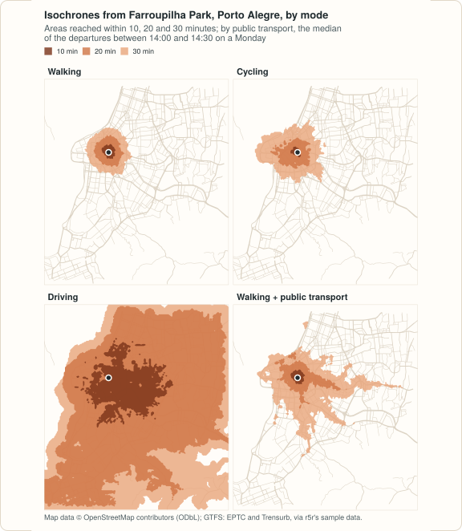

# peabiru (Python) 

[](https://github.com/StrategicProjects/peabiru-routing/actions/workflows/ci.yml)
[](https://github.com/StrategicProjects/peabiru-routing/blob/main/LICENSE-MIT)
[](https://lifecycle.r-lib.org/articles/stages.html#experimental)
[](https://github.com/StrategicProjects/peabiru-routing/tree/main/python)
[](https://pypi.org/project/peabiru/)

Multimodal routing on [OpenStreetMap](https://www.openstreetmap.org) street
networks and [GTFS](https://gtfs.org) public transport: travel-time
matrices, accessibility, minute-by-minute (expanded) and arrival-time
matrices, isochrones, detailed itineraries and transit fares, by walking,
cycling, driving and public transport, with slope costs from an elevation
raster and scenarios of car speeds and traffic stress.

The routing engine is written in Rust and runs inside the Python process:
no Java is needed, the network is built once in memory and reused by every
call, and the results are `pandas.DataFrame`s. The same Rust core powers
the R package of the same name.

<a href="https://github.com/StrategicProjects/peabiru-routing/blob/main/python/docs/example-isochrones.md"></a>

Worked examples (isochrones, access to jobs on a grid, how much a trip
varies) are in the [documentation](https://strategicprojects.github.io/peabiru-routing/python/).

```python
import datetime as dt
import peabiru

network = peabiru.build_network(peabiru.sample_data_path())
points = peabiru.sample_points()          # id, lon, lat, opportunities

ttm = peabiru.travel_time_matrix(
    network, points, points,
    mode=["WALK", "TRANSIT"],
    departure_datetime=dt.datetime(2019, 5, 13, 14, 0),
    percentiles=[25, 50, 75],
    seed=42,
)

access = peabiru.accessibility(
    network, points, points,
    opportunities_colnames="jobs",
    mode="BICYCLE",
    decay_function="logistic",
    cutoffs=[15, 30],
    decay_value=5,
)
```

| Function | What it computes |
|---|---|
| `build_network(data_path)` | a network from a directory with one `.pbf` and any GTFS `.zip` |
| `travel_time_matrix(...)` | travel times between every origin and destination |
| `accessibility(...)` | cumulative or decay-weighted access to opportunities |
| `expanded_travel_time_matrix(...)` | travel times minute by minute, with a breakdown of each trip |
| `arrival_travel_time_matrix(...)` | the latest trip that arrives by a given time |
| `isochrone(...)` | the areas or street segments reached within each cutoff |
| `detailed_itineraries(...)` | the legs of each trip, with their lines |
| `setup_fare_structure(...)`, `pareto_frontier(...)` | transit fares, and the trade-off between travel time and fare |
| `find_snap(...)`, `street_network_to_sf(...)`, `get_gtfs_errors(...)`, ... | where points snap, the streets, stops and routes of a network, the errors of its GTFS feeds |

Points are `pandas.DataFrame`s with `id`, `lon` and `lat` (or, with
geopandas installed, a `GeoDataFrame` of points in EPSG:4326); results are
`pandas.DataFrame`s in long format (`GeoDataFrame`s for geometries). A
request peabiru cannot honour exactly (R5's own fare calculators, expanded
matrices by a street mode alone, ...) is an error; nothing is silently
ignored.

## Install

```sh
pip install peabiru
pip install "peabiru[geo]"     # with geopandas
```

Requires Python 3.9 or later and pandas. The release builds wheels for
Linux with glibc (x86_64 and aarch64), macOS (arm64 and x86_64) and Windows
(x64), one wheel per platform for every Python from 3.9. There are no wheels for
Linux with musl (Alpine) or for Windows on Arm: there pip builds the package
from the source distribution, which needs a Rust toolchain (rustc 1.81 or
later).

From a clone of the repository (needs a Rust toolchain):

```sh
cd python
maturin develop --uv --release
```

## Development

```sh
cd python
uv venv && uv pip install pandas pytest geopandas
maturin develop --uv
.venv/bin/python -m pytest                         # tests, doc examples, doctests
uv pip install "mkdocs>=1.6" "mkdocs-material>=9.5" "mkdocstrings[python]>=0.26"
.venv/bin/mkdocs build --strict                    # documentation site in site/
```

## The engine

The engine is a Rust port of [R5](https://github.com/conveyal/r5) 7.6
(Conveyal, MIT). How its results are checked is described in
[the comparison with r5r](https://strategicprojects.github.io/peabiru-routing/python/coming-from-r5/).

## Sample data

`peabiru.sample_data_path()` is a small network of Sao Paulo, cut from the
sample data of the r5r project. Its `spo_osm.pbf` contains map data (c)
OpenStreetMap contributors, available under the
[Open Database License](https://www.openstreetmap.org/copyright), and
`spo_gtfs.zip` is a GTFS feed of SPTrans, without `shapes.txt`. Their sources are detailed in `LICENSE-THIRD-PARTY`.

## License

MIT. peabiru ports R5 (MIT, Conveyal) and parts of Apache Commons Math
(Apache-2.0); their notices and licence texts are in `LICENSE-THIRD-PARTY`,
shipped with the package. The compiled extension module also contains code
from the Rust crates pyo3, miniz_oxide and others (MIT, Apache-2.0 and
similar licences); their licences are in `LICENSE-RUST-CRATES`, also shipped
with the package.
