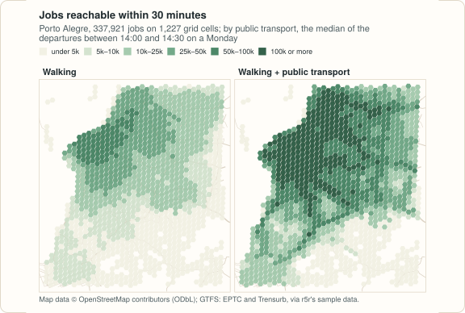

# Example: mapping access to jobs and schools

How many jobs can people reach from where they live? This example answers
that for Porto Alegre, on a grid of hexagonal cells, first walking and then
walking with public transport. The code blocks make one script; the output
shown under each is what it prints. The map at the end needs
[matplotlib](https://matplotlib.org).

<figure markdown="span">
  
  <figcaption>The accessibility computed below. This figure is drawn from the same results, in the style of these pages, by <code>site/figures/figures.R</code> in the repository.</figcaption>
</figure>

## The data

The Porto Alegre sample of r5r 2.5.0 (an OpenStreetMap extract, the bus and
train GTFS feeds, and a grid of 1,227 hexagonal cells with their population,
jobs and schools), downloaded once into the temporary directory:

```python
import datetime as dt
import tempfile
import urllib.request
from pathlib import Path

import pandas as pd

import peabiru

poa = Path(tempfile.gettempdir()) / "peabiru-poa"
poa.mkdir(exist_ok=True)
url = "https://raw.githubusercontent.com/ipea/r5r/v2.5.0/r-package/inst/extdata/poa/"
for name in ["poa_osm.pbf", "poa_eptc.zip", "poa_trensurb.zip",
             "poa_hexgrid.csv", "poa_points_of_interest.csv"]:
    if not (poa / name).exists():
        urllib.request.urlretrieve(url + name, poa / name)

network = peabiru.build_network(poa)
grid = pd.read_csv(poa / "poa_hexgrid.csv")
print(grid.head().to_string())
print(grid[["population", "schools", "jobs"]].sum())
```

```text
                id        lon        lat  population  schools    jobs  healthcare
0  89a901291abffff -51.158246 -30.053846           0        0  1214.0         0.0
1  89a9012a3cfffff -51.211867 -30.100576         159        0     0.0         0.0
2  89a901295b7ffff -51.165206 -30.075442        1008        0     3.0         1.0
3  89a901284a3ffff -51.205354 -30.090046          92        0     0.0         0.0
4  89a9012809bffff -51.195754 -30.078387         577        0     9.0         0.0
population    812935.0
schools          194.0
jobs          337921.0
dtype: float64
```

Each cell is a point at its centre. The bus feed of the sample only has
trips between late morning and early evening on weekdays, so public
transport is routed from 14:00 on a Monday, over a 30-minute window of
departures:

```python
monday = dt.datetime(2019, 5, 13, 14, 0)
```

## Travel times from one point

A first look: the travel time from one place, Farroupilha Park, to the
centre of every cell. Pairs that take longer than `max_trip_duration` are
left out of the result.

```python
poi = pd.read_csv(poa / "poa_points_of_interest.csv")
park = poi[poi["id"] == "farroupilha_park"]

walk = peabiru.travel_time_matrix(network, park, grid, mode="WALK",
                                  max_trip_duration=60)
transit = peabiru.travel_time_matrix(
    network, park, grid, mode=["WALK", "TRANSIT"],
    departure_datetime=monday, time_window=30, max_trip_duration=60,
)
for label, ttm in [("walking", walk), ("public transport", transit)]:
    print(f"{label}: {len(ttm)} cells within an hour, "
          f"median {ttm['travel_time_p50'].median():.0f} min")
```

```text
walking: 268 cells within an hour, median 41 min
public transport: 1100 cells within an hour, median 39 min
```

Within an hour, public transport reaches about four times as many cells as
walking does.

## Jobs and schools within 30 minutes

[`accessibility()`](reference.md#peabiru.accessibility) adds up, for each
origin, the opportunities at every destination reached within the cutoff
(the `"step"` decay function, the default). Five cells have no job count;
they count as zero, with a warning.

```python
import warnings

with warnings.catch_warnings():
    warnings.simplefilter("ignore")      # the five cells without a job count
    access = pd.concat([
        peabiru.accessibility(
            network, grid, grid, opportunities_colnames=["jobs", "schools"],
            mode="WALK", cutoffs=30,
        ).assign(mode="walking"),
        peabiru.accessibility(
            network, grid, grid, opportunities_colnames=["jobs", "schools"],
            mode=["WALK", "TRANSIT"], departure_datetime=monday,
            time_window=30, cutoffs=30,
        ).assign(mode="public transport"),
    ], ignore_index=True)
print(access.head())
```

```text
                id opportunity  percentile  cutoff  accessibility     mode
0  89a901291abffff        jobs          50      30        15978.0  walking
1  89a901291abffff     schools          50      30           12.0  walking
2  89a9012a3cfffff        jobs          50      30          641.0  walking
3  89a9012a3cfffff     schools          50      30            0.0  walking
4  89a901295b7ffff        jobs          50      30         1884.0  walking
```

Weighting each cell by the people who live there gives what the average
resident reaches:

```python
access = access.merge(grid[["id", "population"]], on="id")
average = access.groupby(["mode", "opportunity"]).apply(
    lambda a: round((a["accessibility"] * a["population"]).sum() / a["population"].sum()),
    include_groups=False,
)
print(average.unstack())
```

```text
opportunity        jobs  schools
mode                            
public transport  67725       31
walking           21343       12
```

Public transport roughly triples both: about 21 thousand jobs and 12
schools within half an hour on foot, against 68 thousand jobs and 31
schools with the buses and the train.

## A map

Each cell drawn as a dot at its centre, coloured by the jobs it reaches:

```python
import matplotlib

matplotlib.use("Agg")
import matplotlib.pyplot as plt

jobs = access[access["opportunity"] == "jobs"].merge(grid[["id", "lon", "lat"]], on="id")
fig, axes = plt.subplots(1, 2, figsize=(10, 5), sharex=True, sharey=True)
for ax, (label, cells) in zip(axes, jobs.groupby("mode", sort=False)):
    dots = ax.scatter(cells["lon"], cells["lat"], c=cells["accessibility"] / 1000,
                      s=9, cmap="Greens", vmin=0, vmax=200)
    ax.set_title(label, loc="left", fontweight="bold")
    ax.set_aspect(1 / 0.866)              # degrees of longitude are shorter at 30° S
    ax.set_axis_off()
fig.colorbar(dots, ax=axes, shrink=0.7, label="thousand jobs within 30 min")
fig.savefig("accessibility.png", dpi=110, bbox_inches="tight")
```

## Variations

- **Gradual access.** `decay_function="logistic"` (or `"exponential"`,
  `"linear"`, `"fixed_exponential"`) weights every job by its travel time
  instead of counting those under a hard limit; see
  [Accessibility](accessibility.md).
- **Several cutoffs at once.** `cutoffs=[15, 30, 45]` returns one row per
  cutoff, from a single routing pass.
- **Percentiles.** With `percentiles=[25, 50, 75]`, the accessibility of a
  good, a typical and a bad departure in the window.
