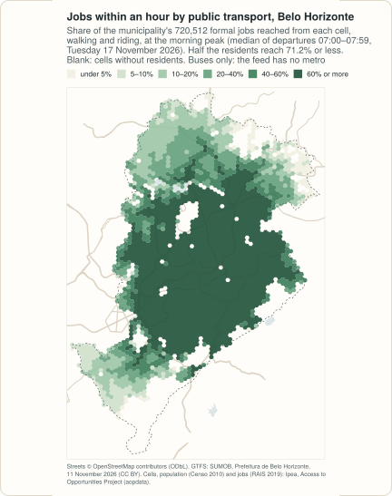
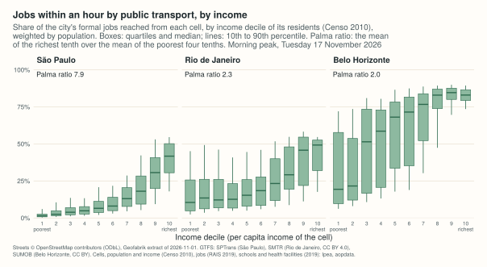
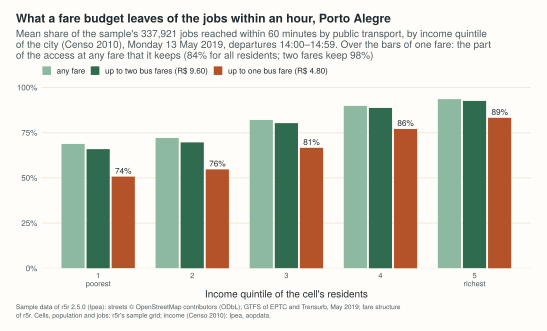
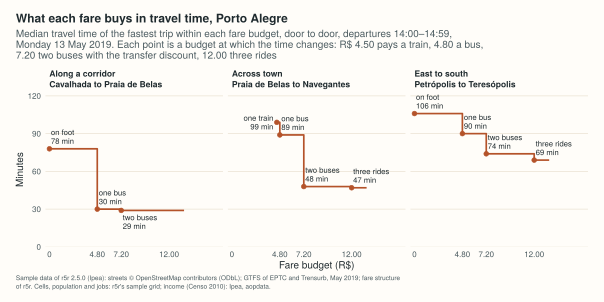
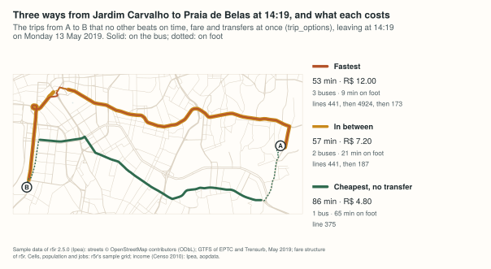

# Example: who reaches the jobs in Belo Horizonte, and what a fare budget leaves

<!-- docs-test: needs osmium, env PEABIRU_EXAMPLE_DATA -->

How many jobs can a resident reach in an hour by bus, and does the answer
depend on how much the household earns? This example measures it for Belo
Horizonte from the city's official GTFS feed, on the grid of Ipea's Access
to Opportunities Project, and then, in Porto Alegre, asks what is left of
that access when the fare is limited.

It is the Python half of a larger example: the
<a href="../../r/articles/capitals.html">R article</a> does the same for São Paulo and
Rio de Janeiro too, compares the three cities, and explains which capitals
were left out and why. The numbers printed here for Belo Horizonte and
Porto Alegre are the ones of that article; they were computed on 2026-11-12.
It needs [geopandas](https://geopandas.org) 1.0 or later and, to cut the
extract, [osmium](https://osmcode.org/osmium-tool/).

<figure markdown="span">
  
  <figcaption>The jobs within an hour by bus, computed below. The figures of this page are drawn from the same results by <code>site/figures/capitals.R</code> in the repository.</figcaption>
</figure>

## The data

| Data | Source | Licence |
|---|---|---|
| Streets | [OpenStreetMap](https://www.openstreetmap.org/copyright), extract of the Sudeste region by [Geofabrik](https://download.geofabrik.de/south-america/brazil/sudeste.html), dated 2026-11-01 (863 MB) | ODbL 1.0 |
| GTFS | [Superintendência de Mobilidade de Belo Horizonte](https://dados.pbh.gov.br/dataset/gtfs) (SUMOB), "GTFS": the conventional and the supplementary bus systems, by timetable; **no** metro. Version 202611111921 (52 MB); the address always serves the current file, rewritten every day | CC BY |
| Municipal boundary | [IBGE, malhas municipais](https://servicodados.ibge.gov.br/api/docs/malhas?versao=3) (API, version 3) | public data, IBGE |
| Cells, population, income | Ipea, [Access to Opportunities Project](https://www.ipea.gov.br/acessooportunidades/en/), data release v1.0.0 of [aopdata](https://github.com/ipeaGIT/aopdata): H3 cells of resolution 9 with the residents and the household income per person of the **Censo 2010** | the aopdata repository is MIT; no separate licence for the data is stated. Ipea asks for the citations at the end of this page |
| Jobs, schools, health facilities | the same release, land use of **2019**: formal jobs (RAIS), public schools, public health facilities, per cell | same |
| Porto Alegre | the sample data of [r5r 2.5.0](https://github.com/ipea/r5r/tree/v2.5.0/r-package/inst/extdata/poa): OpenStreetMap extract, GTFS of EPTC and Trensurb of May 2019, grid, and a fare structure | r5r is under GPL (>= 3) or MIT, at the user's choice; map data ODbL |

The public transport is of November 2026; the residents and their income
are those of 2010 (the Censo 2022 has no income by census tract yet) and the
jobs those of 2019.

```python
import datetime as dt
import gzip
import hashlib
import os
import shutil
import subprocess
import urllib.request
import zipfile
from pathlib import Path

import geopandas as gpd
import numpy as np
import pandas as pd

import peabiru

data_dir = Path(os.environ.get("PEABIRU_EXAMPLE_DATA", "capitals-data"))
raw = data_dir / "raw"
raw.mkdir(parents=True, exist_ok=True)


def fetch(url, name=None, folder=raw):
    dest = folder / (name or url.rsplit("/", 1)[1])
    if not dest.exists():
        part = dest.with_suffix(".part")
        request = urllib.request.Request(url, headers={"User-Agent": "peabiru-docs-examples"})
        with urllib.request.urlopen(request) as response, open(part, "wb") as out:
            # IBGE's API sends its answer gzip-compressed, asked or not
            gz = response.headers.get("Content-Encoding") == "gzip"
            shutil.copyfileobj(gzip.GzipFile(fileobj=response) if gz else response, out)
        part.rename(dest)
    return dest


def aop(name):
    return fetch("https://github.com/ipeaGIT/aopdata/releases/download/v1.0.0/" + name)


sudeste = fetch("https://download.geofabrik.de/south-america/brazil/sudeste-261101.osm.pbf")
feed = fetch("https://s3.amazonaws.com/mobilibus-uploads/gtfs/GTFSBHTRANS.zip", "bhtrans.zip")
print(f"{feed.stat().st_size / 1e6:.1f} MB, sha256", hashlib.sha256(feed.read_bytes()).hexdigest()[:16])
```

```text
52.2 MB, sha256 15d3b184fe8e1e3a
```

A later download is another version of the network and gives other numbers;
the checksum (its first 16 digits) identifies the file used here.

## The network

The streets are cut around the municipality and the stops of the feed, with
3 km to spare; `build_network()` reads the directory with the cut and the
feed.

```python
utm = 31983   # SIRGAS 2000 / UTM zone 23S, in metres

boundary = gpd.read_file(fetch(
    "https://servicodados.ibge.gov.br/api/v3/malhas/municipios/3106200"
    "?formato=application/vnd.geo+json&qualidade=maxima", "3106200.geojson")).to_crs(utm)
with zipfile.ZipFile(feed) as z, z.open("stops.txt") as f:
    stops = pd.read_csv(f, usecols=["stop_lon", "stop_lat"]).dropna()
stops = gpd.GeoSeries(gpd.points_from_xy(stops["stop_lon"], stops["stop_lat"]), crs=4326).to_crs(utm)
# 30 segments per quarter circle, as sf's st_buffer()
area = boundary.make_valid().union_all().union(stops.union_all().convex_hull).buffer(3000, quad_segs=30)

folder = data_dir / "bho" / "network"
folder.mkdir(parents=True, exist_ok=True)
shutil.copyfile(feed, folder / "bhtrans.zip")
polygon = data_dir / "bho" / "cut.geojson"
gpd.GeoSeries([area], crs=utm).to_crs(4326).to_file(polygon)
pbf = folder / "bho.osm.pbf"
subprocess.run(["osmium", "extract", "--overwrite", "-p", str(polygon), str(sudeste),
                "-o", str(pbf)], check=True)
network = peabiru.build_network(folder)
print(f"{area.area / 1e6:.0f} km2, {pbf.stat().st_size / 1e6:.1f} MB")
print(network.info())
```

```text
696 km2, 6.4 MB
{'vertices': 107414, 'edges': 286400, 'elevation': 'NONE', 'feeds': ['bhtrans'], 'stops': 9924, 'patterns': 1118, 'services': 14, 'frequencies': False}
```

Two checks before routing: `build_network()` refuses a feed with errors of
high priority, as r5r does, and
[`get_gtfs_errors()`][peabiru.get_gtfs_errors] lists the others;
[`check_transit_availability()`][peabiru.check_transit_availability] says how
much of the feed runs on the day chosen, Tuesday 17 November 2026.

```python
print(len(peabiru.get_gtfs_errors(network)), "GTFS errors")
print(peabiru.check_transit_availability(network, dates=dt.date(2026, 11, 17)).to_string(index=False))
```

```text
0 GTFS errors
      date  total_services  active_services  pct_active
2026-11-17              14                2    0.142857
```

Few services run because the calendar has one service per kind of day and
of system, and only the weekday ones are due on a Tuesday.

## Residents, income and opportunities

Ipea's grid has, for each cell, the residents (`P001`), the average
household income per person (`R001`), the income decile of the cell among
the residents of the city (`R003`, 1 the poorest tenth), and the formal jobs
(`T001`), public schools (`E001`) and public health facilities (`S001`).
Each cell is routed from, and to, its centre.

```python
grid = gpd.read_file(aop("hex_grid_bho.gpkg"))[["id_hex", "geometry"]]
people = pd.read_csv(aop("population_2010_bho.csv"))[["id_hex", "P001", "R001", "R003"]]
land = pd.read_csv(aop("landuse_2019_bho.csv"))[["id_hex", "T001", "E001", "S001"]]
cells = grid.merge(people, on="id_hex").merge(land, on="id_hex")
cells.columns = ["id", "geometry", "population", "income", "decile", "jobs", "schools", "health"]
centre = cells.geometry.to_crs(utm).centroid.to_crs(4326)
cells["lon"] = centre.x.round(6)
cells["lat"] = centre.y.round(6)
print(len(cells), "cells,", (cells["population"] > 0).sum(), "inhabited,",
      cells["population"].sum(), "residents,", cells["jobs"].sum(), "jobs,",
      cells["schools"].sum(), "schools,", cells["health"].sum(), "health facilities")
```

```text
3049 cells, 2548 inhabited, 2409892 residents, 720512 jobs, 544 schools, 341 health facilities
```

## Access at the morning peak

For every inhabited cell, the jobs, schools and health facilities of the
municipality reached within 30 and within 60 minutes, door to door, walking
and riding, leaving at each minute from 07:00 to 07:59; the travel time to
each destination is the median of those 60 departures.

```python
table = pd.DataFrame(cells.drop(columns="geometry"))
origins = table[table["population"] > 0]
destinations = table[table["jobs"] + table["schools"] + table["health"] > 0]
a = peabiru.accessibility(
    network, origins, destinations, opportunities_colnames=["jobs", "schools", "health"],
    mode=["WALK", "TRANSIT"], departure_datetime=dt.datetime(2026, 11, 17, 7, 0),
    time_window=60, percentiles=50, cutoffs=[30, 60], max_trip_duration=60, seed=42,
    progress=False,
)
a["what"] = a["opportunity"] + "_" + a["cutoff"].astype(str)
wide = a.pivot(index="id", columns="what", values="accessibility")
access = origins.merge(wide, left_on="id", right_index=True)

share = access["jobs_60"] / table["jobs"].sum()
order = np.argsort(share.to_numpy())
half = np.searchsorted(np.cumsum(access["population"].to_numpy()[order]),
                       access["population"].sum() / 2)
print(len(origins), "origins x", len(destinations), "destinations")
print(f"mean {100 * np.average(share, weights=access['population']):.1f}%, "
      f"median {100 * share.to_numpy()[order][half]:.1f}% of the jobs within an hour")
```

```text
2548 origins x 2330 destinations
mean 58.7%, median 71.2% of the jobs within an hour
```

**What these numbers are not.** They count only the opportunities inside
the municipality, and only what the feed has: buses, without the metro
line. Timetables are what the agency planned, not what ran. Formal jobs
leave out informal work.

## By income

The cells of each income decile, weighted by their residents: the mean
share of the city's jobs within an hour, and of its public schools and
health facilities within half an hour. The **Palma ratio** of access is the
mean of the richest tenth over the mean of the poorest four tenths.

```python
def by_decile(column):
    rows = access.dropna(subset="decile")
    share = rows[column] / table[column.split("_")[0]].sum()
    mean = lambda r: np.average(share[r.index], weights=r["population"])
    means = rows.groupby("decile").apply(mean, include_groups=False)
    palma = mean(rows[rows["decile"] == 10]) / mean(rows[rows["decile"] <= 4])
    means.index = means.index.astype(int)
    return pd.concat([(100 * means).round(1), pd.Series({"palma": round(palma, 2)})])


result = pd.DataFrame({c: by_decile(c) for c in ["jobs_60", "schools_30", "health_30"]})
print(result.to_string(float_format="{:g}".format))
```

```text
       jobs_60  schools_30  health_30
1         31.9         3.4        3.2
2         33.1         4.1        3.5
3         46.5         4.9        4.7
4         49.5         5.1        4.7
5         58.2         5.6        6.3
6         59.8           6        7.7
7         67.9         6.6       10.6
8         76.4         7.6       13.7
9         81.4         8.6       18.1
10        82.2         7.4       21.5
palma     2.04        1.66       5.32
```

<figure markdown="span">
  
  <figcaption>The same measure in the three cities of the R article.</figcaption>
</figure>

## Time against fare

A fare is a limit of its own: the fastest trip is of little use to someone
who cannot pay for its transfers. peabiru routes with fares as r5r does: a
*fare structure* says what each ride costs and which transfers are
discounted, `max_fare` keeps the fastest trip within a budget, and
[`pareto_frontier()`][peabiru.pareto_frontier] gives the travel time at each
budget.

Belo Horizonte's feed has the fares by line, but its
[rules](https://prefeitura.pbh.gov.br/sumob/onibus/tipos-de-linha-e-servicos)
cannot be written faithfully in r5r's format (a transfer inside a MOVE
station costs nothing, a second ride within 90 minutes costs half the
cheaper fare); the <a href="../../r/articles/capitals.html#time-against-fare">R article</a>
has the details. So this part uses **Porto Alegre**: the sample data of r5r
2.5.0 (the centre and the neighbourhoods around it, as of May 2019) and the
fare structure r5r ships for it. The feeds only have service in the
afternoon, so the departures are from 14:00 to 14:59 of Monday 13 May 2019.

```python
poa_url = "https://raw.githubusercontent.com/ipea/r5r/v2.5.0/r-package/inst/extdata/poa/"
poa_dir = data_dir / "poa" / "network"
poa_dir.mkdir(parents=True, exist_ok=True)
for name in ["poa_osm.pbf", "poa_eptc.zip", "poa_trensurb.zip"]:
    fetch(poa_url + name, folder=poa_dir)
poa = peabiru.build_network(poa_dir)
fares = peabiru.read_fare_structure(fetch(poa_url + "fares/fares_poa.zip", folder=poa_dir.parent))
print(fares["fares_per_type"].to_string(index=False))
print(fares["fares_per_transfer"].to_string(index=False))
print(fares["max_discounted_transfers"], fares["transfer_time_allowance"])
```

```text
type  unlimited_transfers  allow_same_route_transfer  use_route_fare  fare
 BUS                False                      False           False   4.8
RAIL                 True                      False           False   4.5
first_leg second_leg  fare
      BUS        BUS  7.20
     RAIL        BUS  8.37
      BUS       RAIL  8.37
1 60
```

A bus ride costs R$ 4.80 and a train ride R$ 4.50; two buses within 60
minutes cost R$ 7.20 together, a bus and a train R$ 8.37; one discounted
transfer per trip.

The cells are r5r's sample grid (the same H3 cells as Ipea's), with the
income quintile of each cell in the whole city (`R002`).

```python
poa_cells = pd.read_csv(fetch(poa_url + "poa_hexgrid.csv", folder=poa_dir.parent))
income = pd.read_csv(aop("population_2010_poa.csv"))[["id_hex", "R002"]]
poa_cells = poa_cells.merge(income, left_on="id", right_on="id_hex", how="left")
poa_cells = poa_cells.rename(columns={"R002": "quintile"}).drop(columns="id_hex")
poa_cells["jobs"] = poa_cells["jobs"].fillna(0)   # five cells of the sample have no count
poa_origins = poa_cells[poa_cells["population"] > 0]
poa_destinations = poa_cells[poa_cells["jobs"] > 0]
```

### What a budget leaves

The jobs within an hour with at most one bus fare (R$ 4.80: a single ride),
at most two (R$ 9.60: enough for either discounted transfer), and at any
fare:

```python
poa_departure = dt.datetime(2019, 5, 13, 14, 0)


def with_budget(max_fare):
    a = peabiru.accessibility(
        poa, poa_origins, poa_destinations, opportunities_colnames="jobs",
        mode=["WALK", "TRANSIT"], departure_datetime=poa_departure, time_window=60,
        percentiles=50, cutoffs=60, max_trip_duration=60, fare_structure=fares,
        max_fare=max_fare, draws_per_minute=1, progress=False,
    )
    return a.set_index("id")["accessibility"].reindex(poa_origins["id"]).to_numpy()


budget = poa_origins[["id", "population", "quintile"]].assign(
    one=with_budget(4.8), two=with_budget(9.6), any=with_budget(float("inf")))


def kept(rows):
    m = {b: np.average(rows[b], weights=rows["population"]) for b in ["one", "two", "any"]}
    return pd.Series({"jobs_any_fare": round(m["any"]),
                      "kept_one_fare": round(100 * m["one"] / m["any"], 1),
                      "kept_two_fares": round(100 * m["two"] / m["any"], 1)})


by_quintile = budget.groupby("quintile").apply(kept, include_groups=False)
by_quintile.index = [str(int(q)) for q in by_quintile.index]
by_quintile.loc["all"] = kept(budget)
print(by_quintile.to_string(float_format="{:g}".format))
```

```text
     jobs_any_fare  kept_one_fare  kept_two_fares
1           232415           73.7            95.9
2           243639           75.9            96.6
3           277392           81.2            97.8
4           303605           85.8            98.7
5           316121             89            98.9
all         288518           84.1            98.2
```

<figure markdown="span">
  
  <figcaption>What a fare budget leaves of the jobs within an hour.</figcaption>
</figure>

With fares the router samples departures in the window
(`draws_per_minute=1`: one per minute) instead of trying every minute, as R5
does. One bus fare, which pays a single ride, keeps 84% of the jobs that the
average resident of the sample reaches at any fare, and two fares 98%; the
loss is larger where incomes are lower: in the poorest fifth, one fare keeps
74%, in the richest 89%. The sample is the centre of the city only, so read
the gradient rather than the levels.

### The frontier of a trip

[`pareto_frontier()`][peabiru.pareto_frontier] gives, for a pair, the travel
time at each fare cutoff where it changes: here the median over the
departures of the hour, for three trips (the names of the neighbourhoods are
OpenStreetMap's).

```python
pairs = [("89a9012aed3ffff", "89a9012aa7bffff", "Cavalhada to Praia de Belas"),
         ("89a9012aa7bffff", "89a9012992bffff", "Praia de Belas to Navegantes"),
         ("89a9012830bffff", "89a901284c7ffff", "Petrópolis to Teresópolis")]
for origin, destination, trip in pairs:
    pf = peabiru.pareto_frontier(
        poa, poa_cells[poa_cells["id"] == origin], poa_cells[poa_cells["id"] == destination],
        departure_datetime=poa_departure, time_window=60, fare_structure=fares,
        fare_cutoffs=[0, 4.5, 4.8, 7.2, 8.37, 9.6, 12], seed=42, progress=False,
    )
    steps = ", ".join(f"R$ {c:.2f}: {t} min" for c, t in zip(pf["monetary_cost"], pf["travel_time"]))
    print(f"{trip}: {steps}")
```

```text
Cavalhada to Praia de Belas: R$ 0.00: 78 min, R$ 4.80: 30 min, R$ 7.20: 29 min
Praia de Belas to Navegantes: R$ 4.50: 99 min, R$ 4.80: 89 min, R$ 7.20: 48 min, R$ 12.00: 47 min
Petrópolis to Teresópolis: R$ 0.00: 106 min, R$ 4.80: 90 min, R$ 7.20: 74 min, R$ 12.00: 69 min
```

<figure markdown="span">
  
  <figcaption>What each fare buys in travel time.</figcaption>
</figure>

Along a corridor, one fare is all it takes: a second ride saves a minute.
Across town, one fare buys a trip of an hour and a half, most of it walking
to a line that goes there directly, and the discounted transfer cuts it to
48 minutes. A budget of R$ 0 is the walk, when it fits in the two hours of
`max_trip_duration`.

### The trips themselves

[`trip_options()`][peabiru.trip_options], peabiru's own planner, lists the
trips worth considering between two points: those that no other trip beats
on the chosen criteria at once. From Jardim Carvalho, in the east, to Praia
de Belas, leaving at 14:19:

```python
res = peabiru.trip_options(
    poa, poa_cells[poa_cells["id"] == "89a9012917bffff"],
    poa_cells[poa_cells["id"] == "89a9012aa7bffff"],
    departure_datetime=dt.datetime(2019, 5, 13, 14, 19), time_window=1,
    criteria=["TIME", "FARE", "TRANSFERS"], fare_structure=fares, drop_geometry=True,
    progress=False,
)
print(res.options[["option", "total_time", "fare", "transfers", "walk_time",
                   "description"]].to_string(index=False))
```

```text
 option  total_time  fare  transfers  walk_time                                description
      1        52.6  12.0          2        9.3 WALK > BUS 441 > BUS 4924 > BUS 173 > WALK
      2        56.8   7.2          1       20.9            WALK > BUS 441 > BUS 187 > WALK
      3        86.2   4.8          0       64.8                      WALK > BUS 375 > WALK
```

<figure markdown="span">
  
  <figcaption>The fastest, the cheapest, and the one in between.</figcaption>
</figure>

Three buses take 53 minutes and cost R$ 12.00; two, with the transfer
discount, 57 minutes for R$ 7.20; a single bus costs R$ 4.80 and takes 86
minutes, 65 of them on foot. `res.itineraries` has the legs of each option,
with their geometry unless `drop_geometry=True`.

## What is measured, and what is not

- **Planned service, one day, one hour**: timetables as published; no
  delays, no crowding.
- **The feed's limits**: Belo Horizonte's buses, without the metro; trips
  cannot leave the area cut around the city, and destinations are those of
  the municipality.
- **Old people, old jobs, new buses**: residents and income from the Censo
  2010, opportunities from 2019, public transport from 2026.
- **Fares**: Porto Alegre's are r5r's sample structure for its 2019 sample
  network, not checked here against the tariff decrees of that year, on a
  part of the city and an afternoon hour.

## Sources and citation

Map data © OpenStreetMap contributors, under the ODbL. GTFS: Superintendência
de Mobilidade de Belo Horizonte (CC BY); EPTC and Trensurb, as cut for the
sample data of r5r. Boundary © IBGE. Cells, population, income, jobs,
schools and health facilities:

- Pereira, R. H. M. et al. (2022). *Distribuição espacial de características
  sociodemográficas e localização de empregos e serviços públicos das vinte
  maiores cidades do Brasil*. Texto para Discussão 2772, Ipea.
  <https://doi.org/10.38116/td2772>
- Pereira, R. H. M. et al. (2022). *Estimativas de acessibilidade a empregos
  e serviços públicos via transporte ativo, público e privado nas 20 maiores
  cidades do Brasil em 2017, 2018, 2019*. Texto para Discussão 2800, Ipea.
  <https://doi.org/10.38116/td2800>
