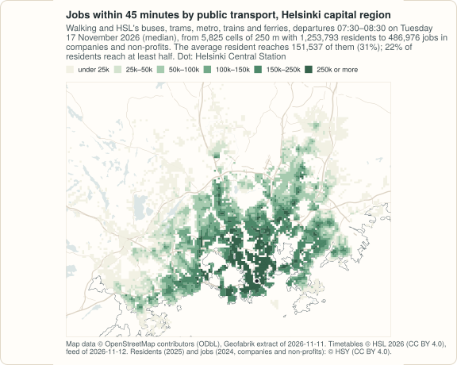

# Example: jobs by public transport in Helsinki

<!-- docs-test: needs osmium, env PEABIRU_EXAMPLE_DATA -->

peabiru reads any OpenStreetMap extract and any valid GTFS feed; nothing
in it is particular to Brazil. This example builds the network of the
Helsinki capital region (Helsinki, Espoo, Vantaa and Kauniainen, 1.25
million residents on HSY's grid) from open data, and measures access to jobs by public
transport at the morning peak.

The code blocks make one script; the output under each is what it prints,
computed on 2026-11-12, and the numbers are those of the
<a href="../../r/articles/helsinki.html">R example</a>, which also explains why Helsinki
was chosen among the candidate cities and why Lisbon was dropped. It
downloads about 880 MB into `PEABIRU_EXAMPLE_DATA` and needs
[geopandas](https://geopandas.org) 1.0 or later and
[osmium](https://osmcode.org/osmium-tool/).

<figure markdown="span">
  
  <figcaption>Jobs within 45 minutes by public transport at the morning peak, computed below and drawn by <code>site/figures/scenarios.R</code> in the repository.</figcaption>
</figure>

## The data

| Data | Source | Licence |
|---|---|---|
| Streets | [OpenStreetMap](https://www.openstreetmap.org/copyright), extract of Finland by [Geofabrik](https://download.geofabrik.de/europe/finland.html), dated 2026-11-11 (776 MB, MD5 `ff7c5c52ce53880611989d15378b13af`), cut with osmium to the box 24.45–25.30° E, 60.03–60.42° N | ODbL 1.0 |
| Public transport | [HSL](https://www.hsl.fi/en/opendata) (Helsinki Region Transport), GTFS feed `https://infopalvelut.storage.hsldev.com/gtfs/hsl.zip`, published 2026-11-12 05:42 (feed_version), valid 2026-11-11 to 2027-01-09, downloaded on 2026-11-12 (88 MB, SHA-256 `1cd6f532…7223c`); the feed is replaced every day | CC BY 4.0 (HSL's open data terms); © HSL 2026 |
| Residents | HSY (Helsinki Region Environmental Services), [*Väestötietoruudukko*](https://www.hsy.fi/en/environmental-information/open-data/avoin-data---sivut/population-grid-of-helsinki-metropolitan-area/) 2025, residents on a 250 m grid (HSY's page of the dataset: updated 2026-07-08), from HSY's open WFS `kartta.hsy.fi` | CC BY 4.0, © HSY |
| Jobs | HSY, [*Työpaikkaruudukko*](https://www.hsy.fi/en/environmental-information/open-data/avoin-data---sivut/grid-data-on-enterprises-and-establishments-in-the-helsinki-region/) 2024, jobs (full-time equivalents) on a 250 m grid (updated 2026-08-26), same WFS | CC BY 4.0, © HSY; original source: Statistics Finland's Business Register |

Cells with fewer than five residents are left out of HSY's population
grid, and one of its cells is not a place: HSY puts the residents it
cannot assign to a building (33,575 in 2025, 2.6% of the total) in a cell
in the sea, at the south-east corner of the grid; it is left out below.
The job grid counts jobs in companies and non-profit organisations only,
**not public-sector jobs**, as full-time equivalents, and gives `-1` for
cells with three or fewer employees, counted as 0 here: "jobs" below are a
lower bound. It covers the
wider Helsinki region (572,915 jobs); the box of this example keeps the
486,976 of the capital region, and leaves out the 42,516 without a
location, which HSY puts in cells in the sea south of the box.

```python
import csv
import datetime as dt
import hashlib
import io
import os
import subprocess
import tempfile
import urllib.request
import zipfile
from pathlib import Path

import geopandas as gpd
import numpy as np
import pandas as pd

import peabiru

root = Path(os.environ.get("PEABIRU_EXAMPLE_DATA", "example-data"))
raw = root / "raw"
raw.mkdir(parents=True, exist_ok=True)
data_dir = root / "helsinki"


def fetch(url, name=None):
    dest = raw / (name or url.rsplit("/", 1)[1])
    if not dest.exists():
        part = dest.with_suffix(".part")
        urllib.request.urlretrieve(url, part)
        part.rename(dest)
    return dest


finland = fetch("https://download.geofabrik.de/europe/finland-261111.osm.pbf")
md5 = hashlib.md5()
with open(finland, "rb") as f:
    for block in iter(lambda: f.read(1 << 20), b""):
        md5.update(block)
assert md5.hexdigest() == "ff7c5c52ce53880611989d15378b13af"
hsl = fetch("https://infopalvelut.storage.hsldev.com/gtfs/hsl.zip")
hsy = ("https://kartta.hsy.fi/geoserver/wfs?service=WFS&version=2.0.0"
       "&request=GetFeature&outputFormat=application/json&srsName=EPSG:4326"
       "&typeNames=asuminen_ja_maankaytto:")
residents_file = fetch(hsy + "Vaestotietoruudukko_2025", "Vaestotietoruudukko_2025.geojson")
jobs_file = fetch(hsy + "Tyopaikkaruudukko_2024", "Tyopaikkaruudukko_2024.geojson")
```

## The network

The streets: the capital region and a margin, cut from the extract of
Finland. The timetables: HSL's feed holds two months of service (its
`stop_times.txt` is 1.1 GB uncompressed), so it is cut to the trips that
run on Tuesday 17 November 2026 and the rows of the other tables they use,
copied unchanged; every stop is kept, and the tables peabiru does not read
are left out (trips of Monday's service that run past midnight are
not in the cut).

```python
(data_dir / "network").mkdir(parents=True, exist_ok=True)
subprocess.run(["osmium", "extract", "--overwrite", "-s", "smart",
                "-b", "24.45,60.03,25.30,60.42", str(finland),
                "-o", str(data_dir / "network" / "helsinki.osm.pbf")], check=True)


def gtfs_one_day(src, date, out):
    """The trips of a GTFS feed that run on `date` (YYYYMMDD), and the rows of
    the other tables that belong to them, copied line by line."""
    z = zipfile.ZipFile(src)

    def table(name):
        return pd.read_csv(z.open(name), dtype=str, keep_default_na=False, encoding="utf-8-sig")

    day = dt.datetime.strptime(date, "%Y%m%d").strftime("%A").lower()
    cal = table("calendar.txt")
    active = set(cal.loc[(cal["start_date"] <= date) & (cal["end_date"] >= date) &
                         (cal[day] == "1"), "service_id"])
    cd = table("calendar_dates.txt")
    cd = cd[cd["date"] == date]
    active = (active - set(cd.loc[cd["exception_type"] == "2", "service_id"])) | \
        set(cd.loc[cd["exception_type"] == "1", "service_id"])
    trips = table("trips.txt")
    trips = trips[trips["service_id"].isin(active)]
    keep = {"trips.txt": ("trip_id", set(trips["trip_id"])),
            "stop_times.txt": ("trip_id", set(trips["trip_id"])),
            "routes.txt": ("route_id", set(trips["route_id"])),
            "shapes.txt": ("shape_id", set(trips["shape_id"])),
            "calendar.txt": ("service_id", active), "calendar_dates.txt": ("service_id", active)}
    tables = [t for t in ["agency.txt", "stops.txt", "routes.txt", "trips.txt",
                          "stop_times.txt", "calendar.txt", "calendar_dates.txt",
                          "frequencies.txt", "transfers.txt", "shapes.txt", "feed_info.txt",
                          "fare_attributes.txt", "fare_rules.txt"] if t in z.namelist()]
    with zipfile.ZipFile(out, "w", zipfile.ZIP_DEFLATED) as o:
        for name in tables:
            with z.open(name) as f, tempfile.TemporaryFile() as buf:
                lines = io.TextIOWrapper(f, encoding="utf-8", newline="")
                header = next(lines)
                buf.write(header.rstrip("\r\n").encode() + b"\n")
                col, ids = keep.get(name, (None, None))
                i = header.lstrip("").rstrip("\r\n").split(",").index(col) if col else None
                for line in lines:
                    if i is None or next(csv.reader([line]))[i] in ids:
                        buf.write(line.rstrip("\r\n").encode() + b"\n")
                buf.seek(0)
                o.writestr(name, buf.read())
    return {"services": len(active), "trips": len(trips)}


print(gtfs_one_day(hsl, "20261117", data_dir / "network" / "hsl.zip"))
print(len(peabiru.get_gtfs_errors(data_dir / "network")))
threads = 4   # of this laptop's ten cores
network = peabiru.build_network(data_dir / "network", n_threads=threads)
print(network.info())
```

```text
{'services': 509, 'trips': 24083}
0
{'vertices': 641401, 'edges': 1662710, 'elevation': 'NONE', 'feeds': ['hsl'], 'stops': 8404, 'patterns': 911, 'services': 509, 'frequencies': False}
```

## Residents and jobs

Each 250 m cell is placed at its centre; the residents are the origins,
the jobs the destinations.

```python
def centres(gdf):
    c = gdf.to_crs(3067).centroid.to_crs(4326)
    return c.x.round(6), c.y.round(6)


residents = gpd.read_file(residents_file)
lon, lat = centres(residents)
cells = pd.DataFrame({"id": residents["index"].astype(str), "lon": lon, "lat": lat,
                      "population": residents["asukkaita"]})
# the cell in the sea with the residents without a building
sea = cells["population"].idxmax()
assert cells.loc[sea, "lat"] == cells["lat"].min() and cells.loc[sea, "lon"] == cells["lon"].max()
print(cells.loc[sea].to_dict())
cells = cells.drop(sea)
j = gpd.read_file(jobs_file)
lon, lat = centres(j)
jobs = pd.DataFrame({"id": j["id"], "lon": lon, "lat": lat,
                     "jobs": j["tphklkm"].clip(lower=0), "suppressed": j["tphklkm"] < 0})
print(jobs["jobs"].sum(), jobs.loc[jobs["lat"] < 60, "jobs"].sum())
jobs = jobs[(jobs["lon"] > 24.45) & (jobs["lon"] < 25.30) &
            (jobs["lat"] > 60.03) & (jobs["lat"] < 60.42)]
print(len(cells), cells["population"].sum(), len(jobs), jobs["jobs"].sum(),
      jobs["suppressed"].sum())
```

```text
{'id': '27699', 'lon': 25.25355, 'lat': 60.05407, 'population': 33575}
572915 42516
5825 1253793 8578 486976 4094
```

## Jobs within reach at the morning peak

Walking and public transport, departures every minute from 07:30 to 08:30
on Tuesday 17 November 2026, the median travel time of each pair:

```python
peak = dt.datetime(2026, 11, 17, 7, 30)
access = peabiru.accessibility(network, cells, jobs, opportunities_colnames="jobs",
                               mode=["WALK", "TRANSIT"], departure_datetime=peak,
                               time_window=60, cutoffs=[30, 45], n_threads=threads)
access["population"] = cells.set_index("id")["population"].loc[access["id"]].to_numpy()
total = jobs["jobs"].sum()
for cutoff, a in access.groupby("cutoff"):
    avg = np.average(a["accessibility"], weights=a["population"])
    half = a.loc[a["accessibility"] >= total / 2, "population"].sum() / a["population"].sum()
    print(cutoff, round(avg), round(avg / total, 3), round(half, 3))
```

```text
30 41169 0.085 0.0
45 151537 0.311 0.223
```

## Isochrones from the Central Station

```python
station = pd.DataFrame({"id": ["Helsinki Central Station"], "lon": [24.94124],
                        "lat": [60.17128]})
for mode in ["WALK", "BICYCLE", "CAR", ["WALK", "TRANSIT"]]:
    iso = peabiru.isochrone(network, station, mode=mode, cutoffs=[15, 30, 45], zoom=10,
                            departure_datetime=peak, time_window=60, n_threads=threads)
    km2 = (iso.to_crs(3067).make_valid().area / 1e6).round(1)
    print(mode, dict(zip(iso["isochrone"], km2)))
```

```text
WALK {45.0: 14.3, 30.0: 6.7, 15.0: 1.6}
BICYCLE {45.0: 84.9, 30.0: 38.0, 15.0: 10.2}
CAR {45.0: 1312.9, 30.0: 478.3, 15.0: 26.0}
['WALK', 'TRANSIT'] {45.0: 238.5, 30.0: 54.0, 15.0: 3.7}
```

The polygons are repaired here with GEOS, which leaves their areas as
contoured; the R package repairs them with `sf::st_make_valid()`,
which with sf's spherical geometry on enlarges the 30-minute driving
polygon to 523.8 km², so the R example switches it off for this call and
prints the same areas. Driving is free flow: no congestion.

## The options for one trip

From Itäkeskus, in the east, to the Aalto University campus at Otaniemi,
in Espoo, leaving between 07:30 and 07:40:

```python
pair = pd.DataFrame({"id": ["Itäkeskus", "Otaniemi"], "lon": [25.0815, 24.8268],
                     "lat": [60.2102, 60.1847]})
opts = peabiru.trip_options(network, pair.iloc[[0]], pair.iloc[[1]], departure_datetime=peak,
                            criteria=["TIME", "TRANSFERS", "WALK"], itineraries=False)
print(opts.options[["option", "total_time", "transfers", "walk_time", "departure_time",
                    "description"]].to_string(index=False))
```

```text
 option  total_time  transfers  walk_time departure_time                                description
      1        39.3          0       10.7       07:30:00                    WALK > SUBWAY M2 > WALK
      2        39.3          0       10.7       07:33:00                    WALK > SUBWAY M1 > WALK
      3        70.3          2       10.3       07:39:00 WALK > BUS 97V > BUS 82 > SUBWAY M2 > WALK
      4        72.0          1        9.3       07:31:00            WALK > BUS 500 > BUS 510 > WALK
```

Map data © OpenStreetMap contributors, under the ODbL; timetables © HSL
2026, CC BY 4.0; residents and jobs © HSY, CC BY 4.0 (jobs: from Statistics Finland's
Business Register).
