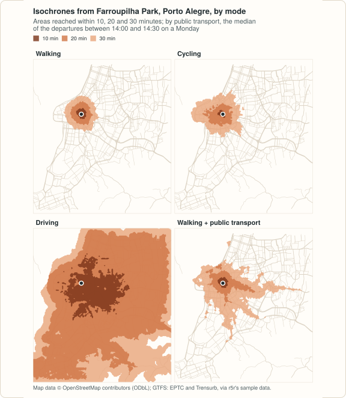

# Example: isochrones by mode

An isochrone is the area within a given travel time of a point. This example
computes them for the four ways of travelling peabiru routes, from one park
in Porto Alegre, and compares how far each mode gets in 10, 20 and 30
minutes. The code blocks make one script; the output shown under each is
what it prints. It needs [geopandas](https://geopandas.org) and, for the
map, [matplotlib](https://matplotlib.org).

<figure markdown="span">
  
  <figcaption>The isochrones computed below. This figure is drawn from the same results, in the style of these pages, by <code>site/figures/figures.R</code> in the repository.</figcaption>
</figure>

## The data

The example uses the Porto Alegre sample of r5r 2.5.0: an OpenStreetMap
extract of the city, the GTFS feeds of its buses (EPTC) and of its
metropolitan train (Trensurb), a hexagonal grid with population, jobs and
schools, and a few points of interest. The files are downloaded once, into
the temporary directory (about 2 MB):

```python
import datetime as dt
import tempfile
import urllib.request
from pathlib import Path

import pandas as pd

import peabiru

poa = Path(tempfile.gettempdir()) / "peabiru-poa"
poa.mkdir(exist_ok=True)
url = "https://raw.githubusercontent.com/ipea/r5r/v2.5.0/r-package/inst/extdata/poa/"
for name in ["poa_osm.pbf", "poa_eptc.zip", "poa_trensurb.zip",
             "poa_hexgrid.csv", "poa_points_of_interest.csv"]:
    if not (poa / name).exists():
        urllib.request.urlretrieve(url + name, poa / name)

network = peabiru.build_network(poa)
print(network.info())
```

```text
{'vertices': 26880, 'edges': 66652, 'feeds': ['poa_trensurb', 'poa_eptc'], 'stops': 4010, 'patterns': 226, 'services': 118, 'frequencies': False}
```

The bus feed of the sample only has trips between late morning and early
evening on weekdays, so public transport is routed from 14:00 on a Monday:

```python
poi = pd.read_csv(poa / "poa_points_of_interest.csv")
park = poi[poi["id"] == "farroupilha_park"]
print(park)
monday = dt.datetime(2019, 5, 13, 14, 0)
```

```text
                 id        lat        lon
7  farroupilha_park -30.036746 -51.216111
```

## Isochrones, mode by mode

[`isochrone()`](reference.md#peabiru.isochrone) returns a `GeoDataFrame`
with one polygon per origin and cutoff. The polygons are made from a grid of
travel times; `zoom` sets how fine that grid is (from 9 to 12; at 11 a cell
is about 65 m wide here). With public transport, the travel time of each
cell is the median over the departures of `time_window`, here the 30 minutes
from 14:00.

```python
modes = {
    "Walking": "WALK",
    "Cycling": "BICYCLE",
    "Driving": "CAR",
    "Walking + public transport": ["WALK", "TRANSIT"],
}
parts = []
for label, mode in modes.items():
    iso = peabiru.isochrone(
        network, park, mode=mode, cutoffs=[10, 20, 30], zoom=11,
        departure_datetime=monday, time_window=30,
    )
    iso["mode"] = label
    parts.append(iso)
isochrones = pd.concat(parts, ignore_index=True)
print(isochrones.drop(columns=isochrones.geometry.name).head(4))
```

```text
                 id  isochrone percentile     mode
0  farroupilha_park       30.0        p50  Walking
1  farroupilha_park       20.0        p50  Walking
2  farroupilha_park       10.0        p50  Walking
3  farroupilha_park       30.0        p50  Cycling
```

The area of each isochrone, in square kilometres, sums up the picture (the
polygons are projected to UTM zone 22S, EPSG:31982, to measure them):

```python
isochrones["area_km2"] = isochrones.to_crs(31982).area.div(1e6).round(1)
print(isochrones.pivot(index="mode", columns="isochrone", values="area_km2")
      .loc[list(modes)])
```

```text
isochrone                   10.0   20.0   30.0
mode                                          
Walking                      0.6    2.7    6.4
Cycling                      0.3    3.2   11.2
Driving                     15.1  102.8  142.6
Walking + public transport   0.6    4.5   20.3
```

Walking covers a couple of kilometres around the park in half an hour.
Cycling covers no more than walking in the first ten minutes from this park,
then pulls ahead. Driving reaches most of the extract within 20 minutes.
Public transport sits in between, and its isochrones follow the bus
corridors leaving the city centre: a stop within a short walk of the park
and a fast ride extend the area far along those lines, and nowhere else.

## A map

With matplotlib, one panel per mode, the largest isochrone drawn first so
that the shorter times stay on top:

```python
import matplotlib

matplotlib.use("Agg")
import matplotlib.pyplot as plt

colours = {10: "#7a3318", 20: "#cf7445", 30: "#e8a57b"}
fig, axes = plt.subplots(2, 2, figsize=(9, 9), sharex=True, sharey=True)
for ax, (label, iso) in zip(axes.flat, isochrones.groupby("mode", sort=False)):
    for cutoff in (30, 20, 10):
        iso[iso["isochrone"] == cutoff].plot(ax=ax, color=colours[cutoff], alpha=0.8)
    ax.plot(park["lon"], park["lat"], "o", color="#1f2a2e", markeredgecolor="white")
    ax.set_title(label, loc="left", fontweight="bold")
    ax.set_axis_off()
fig.savefig("isochrones.png", dpi=110, bbox_inches="tight")
```

## Variations

- **Several origins.** Give `isochrone()` more than one point; the `id`
  column tells the polygons apart.
- **Streets instead of areas.** `polygon_output=False` returns the street
  segments reached, each with its travel time, instead of polygons.
- **Traffic stress.** Cycling uses the streets whose level of traffic stress
  is at most `max_lts` (2 by default) and walks the bike on the others. With
  `max_lts=4`, the 30-minute cycling isochrone from the park grows from
  11.2 to 34.2 km².
- **Uncertainty.** With `percentiles=[25, 50, 75]`, public transport
  isochrones come in one set per percentile: the area reached on a lucky, a
  typical and an unlucky departure.
