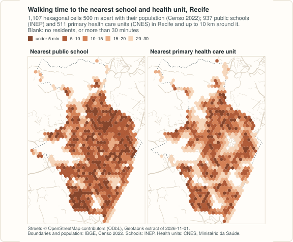
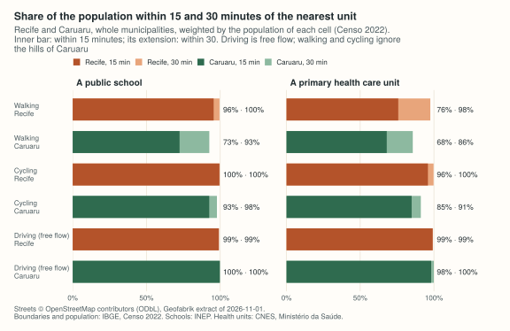
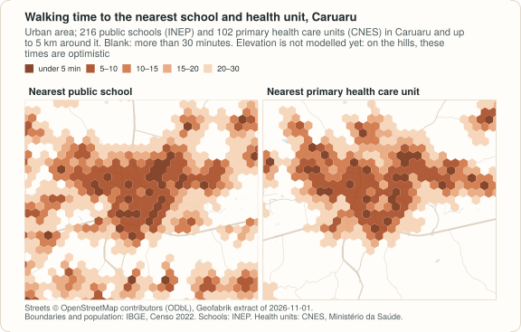
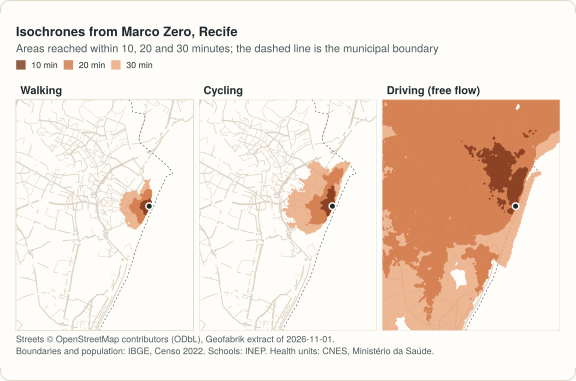
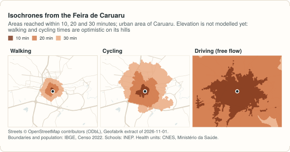

# Example: access to schools and health care in Recife and Caruaru

<!-- docs-test: needs osmium, env PEABIRU_EXAMPLE_DATA -->

The other examples use the small samples that come with r5r. This one
starts from nothing, as a study of a real city would: it downloads the
streets of two cities of Pernambuco, Brazil, from OpenStreetMap, places
their residents on a grid with the census, takes the public schools and the
primary health care units from the official registers, and measures how
long it takes to reach the nearest of each, walking, cycling and driving.

- **Recife**, the state capital (1.49 million people in the Censo 2022), on
  the coast, flat, crossed by rivers. Its street network is cut with 10 km
  around the municipality, which takes in the core of the metropolitan area
  (Olinda, Jaboatão dos Guararapes, Camaragibe and parts of Paulista and São
  Lourenço da Mata), so trips near the border can end in a neighbouring
  municipality.
- **Caruaru**, 130 km inland in the Agreste (378 thousand people), a compact
  city in a large, mostly rural municipality, with 5 km around it.

The code blocks make one script, and every step works for any Brazilian
municipality: change the IBGE code and the buffer. The output shown under
each block is what it prints; it was computed on 2026-11-11. It needs
[geopandas](https://geopandas.org) 1.0 or later and, to cut the extract,
[osmium](https://osmcode.org/osmium-tool/) (`brew install osmium-tool`,
`apt install osmium-tool`, or conda-forge).

<figure markdown="span">
  
  <figcaption>Walking time to the nearest public school and primary health care unit, computed below. The figures of this page are drawn from the same results, in the style of these pages, by <code>site/figures/pernambuco.R</code> in the repository.</figcaption>
</figure>

!!! note "Streets only"
    No public, openly licensed GTFS feed was found for the buses of the
    Grande Recife Consórcio de Transporte or the metro (CBTU): it is not on
    the open-data portals of the city, the state or CBTU, nor in the
    Mobility Database. Caruaru has none either. So this example routes on
    the streets, and leaves public transport out rather than approximate
    it. With a GTFS feed, the same code takes `mode=["WALK", "TRANSIT"]`
    and a departure time.

## The data

| Data | Source | Licence |
|---|---|---|
| Streets | [OpenStreetMap](https://www.openstreetmap.org/copyright), extract of the Nordeste region by [Geofabrik](https://download.geofabrik.de/south-america/brazil/nordeste.html), dated 2026-11-01 (445 MB) | ODbL 1.0 |
| Municipal boundaries | [IBGE, malhas municipais](https://servicodados.ibge.gov.br/api/docs/malhas?versao=3) (API, version 3) | public data, IBGE |
| Population | [IBGE, Censo Demográfico 2022, census tracts with their population](https://ftp.ibge.gov.br/Censos/Censo_Demografico_2022/Agregados_por_Setores_Censitarios/malha_com_atributos/setores/gpkg/UF/PE/), variable `v0001` (44 MB for Pernambuco) | public data, IBGE |
| Schools | INEP, Catálogo de Escolas 2023, with the coordinates of each school, as published by Ipea's [geobr](https://ipeagit.github.io/geobr/) (`schools_2023`, 101 MB for Brazil) | public data, INEP; geobr is MIT |
| Health units | [CNES](https://cnes.datasus.gov.br/), Ministério da Saúde, through [OpenDataSUS](https://opendatasus.saude.gov.br/) (`cnes_estabelecimentos_csv.zip`, 57 MB for Brazil, updated daily; downloaded on 2026-11-11) | open data, Ministério da Saúde |

The files are downloaded once into a directory of their own (set
`PEABIRU_EXAMPLE_DATA` to keep it somewhere else):

```python
import gzip
import os
import shutil
import subprocess
import urllib.request
import zipfile
from pathlib import Path

import geopandas as gpd
import numpy as np
import pandas as pd
from shapely.geometry import Polygon

import peabiru

data_dir = Path(os.environ.get("PEABIRU_EXAMPLE_DATA", "pe-data"))
raw = data_dir / "raw"
raw.mkdir(parents=True, exist_ok=True)


def fetch(url, name=None):
    dest = raw / (name or url.rsplit("/", 1)[1])
    if not dest.exists():
        part = dest.with_suffix(".part")
        with urllib.request.urlopen(url) as response, open(part, "wb") as out:
            # IBGE's API sends its answer gzip-compressed, asked or not
            gz = response.headers.get("Content-Encoding") == "gzip"
            shutil.copyfileobj(gzip.GzipFile(fileobj=response) if gz else response, out)
        part.rename(dest)
    return dest


nordeste = fetch("https://download.geofabrik.de/south-america/brazil/nordeste-261101.osm.pbf")
tracts_file = fetch("https://ftp.ibge.gov.br/Censos/Censo_Demografico_2022/"
                    "Agregados_por_Setores_Censitarios/malha_com_atributos/"
                    "setores/gpkg/UF/PE/PE_setores_CD2022.gpkg")
schools_file = fetch("https://www.ipea.gov.br/geobr/data_gpkg/schools/2023/schools_2023.gpkg")
cnes_file = fetch("https://s3.sa-east-1.amazonaws.com/ckan.saude.gov.br/CNES/"
                  "cnes_estabelecimentos_csv.zip")

cities = pd.DataFrame({"key": ["recife", "caruaru"],
                       "code": ["2611606", "2604106"],   # IBGE codes
                       "buffer": [10000, 5000]})         # metres
utm = 31985   # SIRGAS 2000 / UTM zone 25S, in metres, for both cities
```

## Streets: the municipality and a buffer

The boundary of each municipality comes from IBGE's API. Buffered in
metres, it is the polygon `osmium extract` cuts the regional extract with;
the cut goes in a directory of its own, which `build_network()` reads.

```python
def boundary_of(code):
    url = ("https://servicodados.ibge.gov.br/api/v3/malhas/municipios/" + code +
           "?formato=application/vnd.geo+json&qualidade=maxima")
    b = gpd.read_file(fetch(url, f"{code}.geojson"))
    return b.to_crs(utm).make_valid()


def cut_streets(key, boundary, buffer):
    folder = data_dir / key / "network"
    folder.mkdir(parents=True, exist_ok=True)
    polygon = data_dir / key / "cut.geojson"
    # 30 segments per quarter circle, as sf's st_buffer()
    gpd.GeoSeries(boundary.buffer(buffer, quad_segs=30)).to_crs(4326).to_file(polygon)
    pbf = folder / f"{key}.osm.pbf"
    subprocess.run(["osmium", "extract", "--overwrite", "-p", str(polygon),
                    str(nordeste), "-o", str(pbf)], check=True)
    return folder


boundaries = {k: boundary_of(c) for k, c in zip(cities["key"], cities["code"])}
networks = {}
for k, b in zip(cities["key"], cities["buffer"]):
    folder = cut_streets(k, boundaries[k].geometry, b)
    networks[k] = peabiru.build_network(folder)
    print(k, f"{(folder / f'{k}.osm.pbf').stat().st_size / 1e6:.1f} MB", networks[k].info())
```

```text
recife 16.0 MB {'vertices': 104331, 'edges': 275968, 'feeds': [], 'stops': 0, 'patterns': 0, 'services': 0, 'frequencies': False}
caruaru 1.9 MB {'vertices': 28445, 'edges': 78318, 'feeds': [], 'stops': 0, 'patterns': 0, 'services': 0, 'frequencies': False}
```

## Where people live: a hexagonal grid with the census

The census counts people by tract, and tracts vary from a city block to
hundreds of square kilometres. A regular grid makes the cities comparable:
hexagons 500 m apart, numbered row by row from the south-west, over the
whole municipality. Each cell gets the population of the tracts it covers,
in proportion to the area it covers of each.

```python
def hex_grid(area, spacing=500):
    xmin, ymin, xmax, ymax = area.total_bounds
    h = spacing * np.sqrt(3) / 2
    r = spacing / np.sqrt(3)
    k = np.radians(30 + 60 * np.arange(7))   # pointy side up
    cells = []
    for j in range(-1, int(np.ceil((ymax - ymin) / h)) + 2):
        for i in range(-1, int(np.ceil((xmax - xmin) / spacing)) + 2):
            x = xmin + i * spacing + (j % 2) * spacing / 2
            y = ymin + j * h
            cells.append(Polygon(zip(x + r * np.cos(k), y + r * np.sin(k))))
    cells = gpd.GeoSeries(cells, crs=area.crs)
    cells = cells[cells.intersects(area.union_all())].reset_index(drop=True)
    return gpd.GeoDataFrame({"id": np.arange(1, len(cells) + 1)}, geometry=cells)


def population_grid(code, boundary):
    tracts = gpd.read_file(tracts_file, where=f"CD_MUN = '{code}'", columns=["v0001"])
    tracts = tracts.to_crs(utm)
    tracts["geometry"] = tracts.make_valid()
    tracts["tract_area"] = tracts.area
    cells = hex_grid(boundary)
    parts = gpd.overlay(cells, tracts, how="intersection", keep_geom_type=True)
    parts["people"] = parts["v0001"] * parts.area / parts["tract_area"]
    cells["population"] = cells["id"].map(parts.groupby("id")["people"].sum()).fillna(0)
    centres = cells.centroid.to_crs(4326)
    cells["lon"], cells["lat"] = centres.x.round(6), centres.y.round(6)
    cells["id"] = cells["id"].astype(str)
    return cells[cells["population"] > 0]


grids = {}
for k, code in zip(cities["key"], cities["code"]):
    grids[k] = population_grid(code, boundaries[k])
    print(f"{k:8} {len(grids[k]):5} cells, {grids[k]['population'].sum():,.0f} people")
```

```text
recife    1107 cells, 1,488,797 people
caruaru   4489 cells, 378,048 people
```

The Censo 2022 counts 1,488,924 people in Recife and 378,048 in Caruaru;
the grid keeps all but 127 in Recife, in tracts that reach slightly outside
IBGE's municipal boundary. Caruaru's grid has four times as many cells as
Recife's for a quarter of the people: most of the municipality is rural, and
its large rural tracts spread a few people over each cell.

## Schools and health units

Schools: those of INEP's catalogue that are public (municipal, state or
federal) and open with no restriction, and have coordinates. Health units:
the CNES establishments of types 1 (*posto de saúde*) and 2 (*centro de
saúde / unidade básica*), the primary health care units of the SUS, that
are active and have coordinates. Both are taken over the whole area cut
from OpenStreetMap, so the nearest unit can be across the municipal border,
as it often is for people living near it.

```python
def cut_area(key):
    return gpd.read_file(data_dir / key / "cut.geojson").to_crs(4674).union_all()


def schools_in(area):
    s = gpd.read_file(
        schools_file, bbox=area.bounds,
        columns=["code_school", "name_school", "name_muni"],
        where="admin_category = 'Pública' AND service_restriction = "
              "'ESCOLA EM FUNCIONAMENTO E SEM RESTRIÇÃO DE ATENDIMENTO'",
    )
    s = s[~s.geometry.is_empty & s.intersects(area)]
    return pd.DataFrame({"id": s["code_school"].astype(str), "name": s["name_school"],
                         "municipality": s["name_muni"],
                         "lon": s.geometry.x, "lat": s.geometry.y}).reset_index(drop=True)


with zipfile.ZipFile(cnes_file) as z, z.open("cnes_estabelecimentos.csv") as f:
    cnes = pd.read_csv(f, sep=";", encoding="latin1", dtype=str, keep_default_na=False,
                       usecols=["CO_CNES", "CO_UF", "CO_IBGE", "NO_FANTASIA", "TP_UNIDADE",
                                "CO_MOTIVO_DESAB", "NU_LATITUDE", "NU_LONGITUDE"])
cnes = cnes[(cnes["CO_UF"] == "26") & cnes["TP_UNIDADE"].isin(["1", "2"])
            & (cnes["CO_MOTIVO_DESAB"] == "") & (cnes["NU_LATITUDE"] != "")]


def health_in(area):
    h = pd.DataFrame({"id": cnes["CO_CNES"], "name": cnes["NO_FANTASIA"],
                      "municipality_code": cnes["CO_IBGE"],
                      "lon": cnes["NU_LONGITUDE"].astype(float),
                      "lat": cnes["NU_LATITUDE"].astype(float)})
    inside = gpd.GeoSeries(gpd.points_from_xy(h["lon"], h["lat"])).intersects(area).values
    return h[inside].reset_index(drop=True)


schools = {k: schools_in(cut_area(k)) for k in cities["key"]}
health = {k: health_in(cut_area(k)) for k in cities["key"]}
print(pd.DataFrame({k: {"schools": len(schools[k]), "health_units": len(health[k])}
                    for k in cities["key"]}))
```

```text
              recife  caruaru
schools          937      216
health_units     511      102
```

A few things to know about these registers, seen while preparing them:

- Of the public schools in operation, 22 of 486 in Recife and 15 of 168 in
  Caruaru have no coordinates in the catalogue and cannot be placed; they
  are left out.
- Of the 167 active primary care units registered in Recife, six have
  coordinates outside the municipality: four a few hundred metres across
  the border, but one 24 km away, on the Ilha de Itamaracá, and one 20 km
  away, in Moreno. In Caruaru, two of 75 do, one of them 5 km out. Taking
  units by where they are rather than where they are registered keeps the
  far ones out of these figures (they fall outside the cut area), but those
  units are missing from their own neighbourhoods.
- Schools and health units sit close to the streets of the extract: the
  median distance to the nearest street is 7 to 16 m, and a single school
  in each city is more than 300 m from one (418 m in Recife, 574 m in
  Caruaru), well within the 1.6 km at which peabiru, like r5r, links a
  point to the street network.

## Travel time to the nearest school and health unit

One travel-time matrix per city, mode and kind of unit, from every cell to
every unit; the smallest time of each cell is its time to the nearest one.
Driving is free flow (no congestion), and these networks are built without
an elevation raster (a `.tif` raster in the data directory adds slope
costs, see `build_network()`). The
[terrain example](../../r/articles/terrain.html#recife-and-caruaru-as-published)
of the R site recomputes the shares below with slopes: on foot, within 15
minutes of a health unit, Recife goes from 75.8% to 73.7% and Caruaru from
68.0% to 65.8%, and within 30 minutes or by bicycle very little changes.

```python
def nearest(k, mode, limit):
    out = grids[k][["id", "lon", "lat", "population"]].copy()
    for what, units in [("schools", schools[k]), ("health", health[k])]:
        m = peabiru.travel_time_matrix(networks[k], out, units, mode=mode,
                                       max_trip_duration=limit)
        out[what] = out["id"].map(m.groupby("from_id")["travel_time_p50"].min())
    return out                                  # NaN: none within the limit


def share_within(t, minutes):
    return [round(100 * t["population"][t[what] <= minutes].sum() / t["population"].sum(), 1)
            for what in ["schools", "health"]]


rows = []
for k in cities["key"]:
    for mode in ["WALK", "BICYCLE", "CAR"]:
        t = nearest(k, mode, limit=60)
        rows.append([k, mode, *share_within(t, 15), *share_within(t, 30)])
shares = pd.DataFrame(rows, columns=["city", "mode", "school_15", "health_15",
                                     "school_30", "health_30"])
print(shares)
```

```text
      city     mode  school_15  health_15  school_30  health_30
0   recife     WALK       95.6       75.8       99.6       97.5
1   recife  BICYCLE       99.5       96.0       99.8       99.8
2   recife      CAR       99.2       99.2       99.2       99.2
3  caruaru     WALK       72.5       68.0       92.7       85.7
4  caruaru  BICYCLE       92.7       84.9       97.9       91.1
5  caruaru      CAR       99.8       98.2      100.0       99.9
```

The table is the share of the population (in %) within 15 and 30 minutes
of the nearest public school and primary health care unit. In Recife, 96%
of the people live within 15 minutes' walk of a public school and 76% of a
health unit; in Caruaru, 73% and 68%. On a bicycle the gap narrows; by car,
with free-flowing traffic, nearly everyone is within 15 minutes of both.

Recife's driving shares stop at 99.2% for a reason worth knowing: from 17
cells of Boa Viagem (about 12 thousand residents on this grid) there is no
car route to the rest of the network on this extract, in peabiru and in r5r
2.5.0 alike, although the streets connect on foot and by bicycle. Removing
every turn restriction from the extract does not reconnect them; the cause
is in how the OpenStreetMap data of that area is read for cars, and is not
identified yet. Checks like this one (cells or units that a mode never
reaches) are worth running on any new extract.

<figure markdown="span">
  
</figure>

<figure markdown="span">
  
</figure>

## How many units within reach

The nearest unit is one measure; how many units are within reach is
another, which [`accessibility()`](reference.md#peabiru.accessibility)
computes directly: here, the public schools within 15 minutes' walk of each
cell, and the average over the population.

```python
for k in cities["key"]:
    a = peabiru.accessibility(networks[k], grids[k][["id", "lon", "lat"]],
                              schools[k].assign(n=1), opportunities_colnames=["n"],
                              mode="WALK", cutoffs=15)
    people = a["id"].map(grids[k].set_index("id")["population"])
    print(k, round((a["accessibility"] * people).sum() / people.sum(), 1))
```

```text
recife 4.6
caruaru 2.6
```

On average, a resident of Recife has between four and five public schools
within a quarter of an hour on foot; one of Caruaru, between two and three.

## Isochrones from the centre

From Marco Zero, in Recife's old centre, and from the Feira de Caruaru, the
area reached in 10, 20 and 30 minutes by each mode, in square kilometres:

```python
centres = {
    "recife": pd.DataFrame({"id": ["Marco Zero"], "lon": [-34.8709722], "lat": [-8.063374]}),
    "caruaru": pd.DataFrame({"id": ["Feira de Caruaru"], "lon": [-35.9713866],
                             "lat": [-8.2897512]}),
}
rows = []
for k in cities["key"]:
    for mode in ["WALK", "BICYCLE", "CAR"]:
        iso = peabiru.isochrone(networks[k], centres[k], mode=mode,
                                cutoffs=[10, 20, 30], zoom=11)
        # the polygons come as traced, which can touch themselves: made valid
        # before measuring, as R's isochrone() returns them
        for minutes, km2 in zip(iso["isochrone"], iso.to_crs(utm).make_valid().area / 1e6):
            rows.append([k, mode, int(minutes), round(km2, 1)])
iso = pd.DataFrame(rows, columns=["city", "mode", "minutes", "km2"])
print(iso.pivot_table(index=["city", "mode"], columns="minutes", values="km2"))
```

```text
minutes            10     20     30
city    mode                       
caruaru BICYCLE   1.2    8.9   23.4
        CAR      22.1  248.9  696.4
        WALK      0.1    1.5    4.7
recife  BICYCLE   0.8    3.0    8.2
        CAR       5.7  112.5  367.6
        WALK      0.4    1.3    3.0
```

One number here depends on more than routing: the 20-minute driving polygon
of Caruaru has dozens of holes (pockets of the grid not reached in time) that
touch each other. `isochrone()` returns the polygons as traced, and
`make_valid()` (GEOS, in metres) repairs them keeping those holes: 248.9 km².
The R package returns its polygons made valid as r5r does, with
`sf::st_make_valid()` on longitude and latitude (s2), which merges many of
the holes into the polygon: 285.9 km² in the
<a href="../../r/articles/recife-caruaru.html">R example</a>. The other polygons agree
to 0.1 km².


<figure markdown="span">
  
</figure>

<figure markdown="span">
  
</figure>

## A map

Each cell drawn as a dot at its centre, coloured by the walking time to the
nearest health unit (needs [matplotlib](https://matplotlib.org)):

```python
import matplotlib

matplotlib.use("Agg")
import matplotlib.pyplot as plt

walk = nearest("recife", "WALK", limit=60)
fig, ax = plt.subplots(figsize=(6, 7))
dots = ax.scatter(walk["lon"], walk["lat"], c=walk["health"].fillna(60), s=12,
                  cmap="OrRd_r", vmin=0, vmax=30)
ax.set_aspect(1 / np.cos(np.radians(8)))
ax.set_axis_off()
fig.colorbar(dots, ax=ax, shrink=0.6, label="minutes to the nearest health unit, walking")
fig.savefig("recife-health.png", dpi=110, bbox_inches="tight")
```

## Variations

- **Another municipality.** Change `cities`: the IBGE code (from
  `https://servicodados.ibge.gov.br/api/v1/localidades/municipios`), the
  buffer, the state of the census tracts (`UF/PE/PE_setores_CD2022.gpkg`)
  and of the CNES rows (`CO_UF`), and the Geofabrik region.
- **Large matrices on disk.** With `output_dir`,
  [`travel_time_matrix()`](reference.md#peabiru.travel_time_matrix) and
  `accessibility()` write one CSV file per origin, as r5r does, instead of
  returning a data frame: the 4,489 × 216 driving matrix of Caruaru never
  has to fit in memory.
- **Gradual access.** `decay_function="logistic"` (or `"exponential"`,
  `"linear"`) in `accessibility()` weighs each school by its distance in
  time instead of counting those under a hard limit.
- **Public transport.** With a GTFS feed in the network directory, the same
  calls take `mode=["WALK", "TRANSIT"]`, a `departure_datetime` and a
  `time_window`.
- **A browser map.** The [isochrone demo](../../demo/) has the streets of
  Recife and of the urban area of Caruaru and draws isochrones wherever you
  click.

Map data © OpenStreetMap contributors, under the ODbL; boundaries and
population © IBGE; schools: INEP (Catálogo de Escolas 2023, via geobr);
health units: CNES, Ministério da Saúde.
