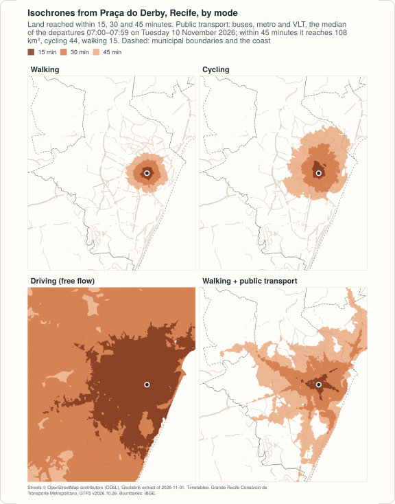
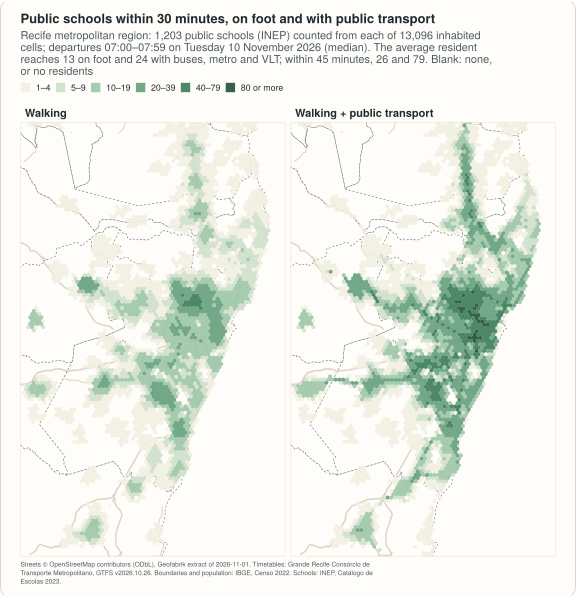

# Example: the Recife metropolitan region by public transport

<!-- docs-test: needs osmium, env PEABIRU_EXAMPLE_DATA -->

The Região Metropolitana do Recife is 14 municipalities and 3.7 million
people on the coast of Pernambuco, Brazil. Its buses, of ten operators
under one authority, the Grande Recife Consórcio de Transporte
Metropolitano, meet the metro and the VLT (light rail) of CBTU at integrated
terminals, and the consortium publishes the timetables of all of them as one
GTFS feed. This example builds the region as one network, from that feed and
from OpenStreetMap, counts the public schools within reach of every resident
on foot and by public transport, and draws isochrones by mode from the
centre of Recife.

It is the Python half of a larger example: the
<a href="../../r/articles/recife-metropolitan.html">R article</a> also
measures what the rail lines add, how much a trip varies with the minute one
leaves, the options of one trip, and the speeds the timetable assumes. The
numbers printed here are the ones of that article; they were computed on
2026-11-13. It needs [geopandas](https://geopandas.org) 1.0 or later and, to
cut the street extract, [osmium](https://osmcode.org/osmium-tool/).

<figure markdown="span">
  
  <figcaption>From Praça do Derby by each mode, computed below; drawn by <code>site/figures/rmr.R</code> in the repository.</figcaption>
</figure>

## The data

| Data | Source | Licence |
|---|---|---|
| Public transport | [Grande Recife Consórcio de Transporte Metropolitano](https://www.granderecife.pe.gov.br), GTFS feed at `https://www.granderecife.pe.gov.br/gtfs/gtfs.zip`, `feed_version` **v2026.10.26** (files of 2026-10-26; 38 MB): 395 bus routes of ten operators and, of CBTU's Metrorec, 3 metro and 2 VLT routes; timetables only | published by the consortium at that address; no licence is stated in the feed |
| Streets | [OpenStreetMap](https://www.openstreetmap.org/copyright), extract of the Nordeste region by [Geofabrik](https://download.geofabrik.de/south-america/brazil/nordeste.html), dated 2026-11-01 (445 MB, MD5 `93318fcddd85a53e8386eaa93588847c`) | ODbL 1.0 |
| Municipal boundaries | [IBGE, malhas municipais](https://servicodados.ibge.gov.br/api/docs/malhas?versao=3) (API, version 3) | public data, IBGE |
| Population | [IBGE, Censo Demográfico 2022, census tracts with their population](https://ftp.ibge.gov.br/Censos/Censo_Demografico_2022/Agregados_por_Setores_Censitarios/malha_com_atributos/setores/gpkg/UF/PE/), variable `v0001` (44 MB for Pernambuco) | public data, IBGE |
| Schools | INEP, Catálogo de Escolas 2023, with the coordinates of each school, as published by Ipea's [geobr](https://ipeagit.github.io/geobr/) (`schools_2023`, 101 MB for Brazil) | public data, INEP; geobr is MIT |

The feed is not in the repository and is not redistributed: the code below
uses a file `granderecife-*.zip` in the `raw` directory if there is one, or
else downloads the consortium's current file. That address always serves
the current version, so a later download is another network and gives other
numbers; the checksum printed identifies the file used here.

!!! note "No fares"
    The feed has a price for each route and no rule for transfers: the
    integration at the terminals, where passengers change lines without
    paying again, is not in it. A fare structure made from the feed would
    charge every boarding, so this example measures time and leaves money
    out.

```python
import datetime as dt
import gzip
import hashlib
import os
import shutil
import subprocess
import urllib.request
import zipfile
from pathlib import Path

import geopandas as gpd
import numpy as np
import pandas as pd
import shapely
from shapely.geometry import Polygon

import peabiru

data_dir = Path(os.environ.get("PEABIRU_EXAMPLE_DATA", "rmr-data"))
raw = data_dir / "raw"
raw.mkdir(parents=True, exist_ok=True)


def fetch(url, name=None):
    dest = raw / (name or url.rsplit("/", 1)[1])
    if not dest.exists():
        part = dest.with_suffix(".part")
        request = urllib.request.Request(url, headers={"User-Agent": "peabiru-docs-examples"})
        with urllib.request.urlopen(request) as response, open(part, "wb") as out:
            # IBGE's API sends its answer gzip-compressed, asked or not
            gz = response.headers.get("Content-Encoding") == "gzip"
            shutil.copyfileobj(gzip.GzipFile(fileobj=response) if gz else response, out)
        part.rename(dest)
    return dest


nordeste = fetch("https://download.geofabrik.de/south-america/brazil/nordeste-261101.osm.pbf")
tracts_file = fetch("https://ftp.ibge.gov.br/Censos/Censo_Demografico_2022/"
                    "Agregados_por_Setores_Censitarios/malha_com_atributos/"
                    "setores/gpkg/UF/PE/PE_setores_CD2022.gpkg")
schools_file = fetch("https://www.ipea.gov.br/geobr/data_gpkg/schools/2023/schools_2023.gpkg")

feeds = sorted(raw.glob("granderecife-*.zip"))
if feeds:
    feed = feeds[-1]
else:
    download = fetch("https://www.granderecife.pe.gov.br/gtfs/gtfs.zip")
    with zipfile.ZipFile(download) as z, z.open("feed_info.txt") as f:
        version = pd.read_csv(f)["feed_version"][0]
    feed = download.rename(raw / f"granderecife-{version}.zip")
print(feed.name, f"{feed.stat().st_size / 1e6:.1f} MB, sha256",
      hashlib.sha256(feed.read_bytes()).hexdigest()[:16])
with zipfile.ZipFile(feed) as z:
    routes = pd.read_csv(z.open("routes.txt"))
    print(routes["route_type"].map({0: "VLT", 1: "metro", 3: "bus"}).value_counts().to_dict(),
          "frequencies.txt" in z.namelist())
```

```text
granderecife-v2026.10.26.zip 38.3 MB, sha256 1b0657fb8f6bcb70
{'bus': 395, 'metro': 3, 'VLT': 2} False
```

## The network

The streets are cut from the regional extract with the 14 municipalities and
3 km around them. (Neighbouring boundaries do not share their vertices
exactly: snapped to a grid of 1 cm, they join without slivers.)
`build_network()` reads the directory with the cut and the feed.

```python
utm = 31985   # SIRGAS 2000 / UTM zone 25S, in metres
threads = 4   # of this laptop's ten cores
# the municipalities of the region (IBGE codes): Recife, Olinda, Jaboatão dos
# Guararapes, Paulista, Camaragibe, São Lourenço da Mata, Cabo de Santo
# Agostinho, Ipojuca, Moreno, Igarassu, Abreu e Lima, Itapissuma, Ilha de
# Itamaracá and Araçoiaba
codes = ["2611606", "2609600", "2607901", "2610707", "2603454", "2613701", "2602902",
         "2607208", "2609402", "2606804", "2600054", "2607752", "2607604", "2601052"]


def boundary_of(code):
    url = ("https://servicodados.ibge.gov.br/api/v3/malhas/municipios/" + code +
           "?formato=application/vnd.geo+json&qualidade=maxima")
    return gpd.read_file(fetch(url, f"{code}.geojson")).to_crs(utm).make_valid().union_all()


municipalities = gpd.GeoSeries([boundary_of(c) for c in codes], index=codes, crs=utm)
municipalities = gpd.GeoSeries(shapely.set_precision(municipalities.values, 0.01),
                               index=codes, crs=utm).make_valid()
region = municipalities.union_all()

folder = data_dir / "rmr" / "network"
folder.mkdir(parents=True, exist_ok=True)
polygon = data_dir / "rmr" / "cut.geojson"
# 30 segments per quarter circle, as sf's st_buffer()
gpd.GeoSeries([region.buffer(3000, quad_segs=30)], crs=utm).to_crs(4326).to_file(polygon)
pbf = folder / "rmr.osm.pbf"
subprocess.run(["osmium", "extract", "--overwrite", "-p", str(polygon), str(nordeste),
                "-o", str(pbf)], check=True)
shutil.copyfile(feed, folder / feed.name)
network = peabiru.build_network(folder, n_threads=threads)
print(f"{region.area / 1e6:,.0f} km2, {pbf.stat().st_size / 1e6:.1f} MB")
print(network.info())
print(len(peabiru.get_gtfs_errors(network)), "GTFS errors")
print(peabiru.check_transit_availability(network, dates=dt.date(2026, 11, 10)).to_string(index=False))
```

```text
2,763 km2, 21.2 MB
{'vertices': 153798, 'edges': 395862, 'elevation': 'NONE', 'feeds': ['granderecife-v2026.10.26'], 'stops': 7238, 'patterns': 1215, 'services': 1143, 'frequencies': False}
0 GTFS errors
      date  total_services  active_services  pct_active
2026-11-10            1143              395    0.345582
```

The feed has no error. Few of its services run because it keeps one for each
route and kind of day, and on a Tuesday the weekday ones are due. The
analysis is of **Tuesday 10 November 2026, leaving at each minute from 07:00
to 07:59**; a travel time is the median of those 60 departures.

## Residents and schools

The census population goes on hexagonal cells 500 m apart, by the share of
each tract's area that falls in each cell, and every cell is routed from its
centre, as in the [Recife and Caruaru example](example-recife-caruaru.md),
which explains these steps. The schools are the public ones in operation in
the area cut.

```python
def hex_grid(area, spacing=500):
    xmin, ymin, xmax, ymax = area.bounds
    h = spacing * np.sqrt(3) / 2
    r = spacing / np.sqrt(3)
    k = np.radians(30 + 60 * np.arange(7))   # pointy side up
    cells = []
    for j in range(-1, int(np.ceil((ymax - ymin) / h)) + 2):
        for i in range(-1, int(np.ceil((xmax - xmin) / spacing)) + 2):
            x = xmin + i * spacing + (j % 2) * spacing / 2
            y = ymin + j * h
            cells.append(Polygon(zip(x + r * np.cos(k), y + r * np.sin(k))))
    cells = gpd.GeoSeries(cells, crs=utm)
    cells = cells[cells.intersects(area)].reset_index(drop=True)
    return gpd.GeoDataFrame({"id": np.arange(1, len(cells) + 1)}, geometry=cells)


tracts = gpd.read_file(tracts_file, columns=["v0001"],
                       where="CD_MUN IN (" + ", ".join(f"'{c}'" for c in codes) + ")").to_crs(utm)
tracts["geometry"] = tracts.make_valid()
tracts["tract_area"] = tracts.area
cells = hex_grid(region)
parts = gpd.overlay(cells, tracts, how="intersection", keep_geom_type=True)
parts["people"] = parts["v0001"] * parts.area / parts["tract_area"]
cells["population"] = cells["id"].map(parts.groupby("id")["people"].sum()).fillna(0)
centres = cells.centroid.to_crs(4326)
cells["lon"], cells["lat"] = centres.x.round(6), centres.y.round(6)
cells["id"] = cells["id"].astype(str)
cells = cells[cells["population"] > 0]

area = gpd.read_file(polygon).to_crs(4674).union_all()
s = gpd.read_file(
    schools_file, bbox=area.bounds, columns=["code_school", "name_school", "name_muni"],
    where="admin_category = 'Pública' AND service_restriction = "
          "'ESCOLA EM FUNCIONAMENTO E SEM RESTRIÇÃO DE ATENDIMENTO'")
s = s[~s.geometry.is_empty & s.intersects(area)]
schools = pd.DataFrame({"id": s["code_school"].astype(str), "lon": s.geometry.x,
                        "lat": s.geometry.y, "schools": 1}).reset_index(drop=True)
print(f"{len(cells):,} cells, {cells['population'].sum():,.0f} people, {len(schools):,} schools")
```

```text
13,096 cells, 3,730,664 people, 1,203 schools
```

## Schools within reach

Cumulative access from every inhabited cell: the public schools reached
within 30 and within 45 minutes, on foot and by public transport, and the
average over the residents.

```python
departure = dt.datetime(2026, 11, 10, 7, 0)
origins = cells[["id", "lon", "lat"]]
people = cells.set_index("id")["population"]

rows = {}
for name, mode in [("walk", "WALK"), ("transit", ["WALK", "TRANSIT"])]:
    a = peabiru.accessibility(network, origins, schools, opportunities_colnames="schools",
                              mode=mode, departure_datetime=departure, time_window=60,
                              percentiles=50, cutoffs=[30, 45], max_trip_duration=60,
                              n_threads=threads, progress=False)
    a["population"] = people.loc[a["id"]].to_numpy()
    rows[name] = {f"{cutoff:.0f} min": round(np.average(g["accessibility"], weights=g["population"]), 1)
                  for cutoff, g in a.groupby("cutoff")}
print(pd.DataFrame(rows))
```

```text
        walk  transit
30 min  12.8     24.4
45 min  26.5     79.4
```

The average resident has 13 public schools within half an hour's walk and 24
within half an hour by public transport; with 45 minutes, 26 and 79.

<figure markdown="span">
  
  <figcaption>The same counts, cell by cell.</figcaption>
</figure>

## Isochrones from the centre

From Praça do Derby, between the centre of Recife and its west and north:
74 of the feed's 400 routes stop within 400 m of the square on a weekday.
[`isochrone()`][peabiru.isochrone]
traces the areas on a grid of points, and the points just off the coast are
reached from the seafront, so the polygons are cut at the coast (the
municipal boundaries) before their area is measured. Walking is at 3.6 km/h
and cycling at 12 km/h on streets of low traffic stress, the defaults;
driving is at the speed limits, with no congestion.

```python
derby = pd.DataFrame({"id": ["Praça do Derby"], "lon": [-34.8990], "lat": [-8.0570]})
rows = {}
for name, mode in [("walk", "WALK"), ("bicycle", "BICYCLE"), ("car", "CAR"),
                   ("transit", ["WALK", "TRANSIT"])]:
    iso = peabiru.isochrone(network, derby, mode=mode, cutoffs=[15, 30, 45], zoom=11,
                            departure_datetime=departure, time_window=60, n_threads=threads)
    # the polygons come as traced, which can touch themselves: made valid first
    on_land = iso.to_crs(utm).make_valid().intersection(region)
    rows[name] = {f"{minutes:.0f} min": round(km2, 1)
                  for minutes, km2 in zip(iso["isochrone"], on_land.area / 1e6)}
print(pd.DataFrame(rows).T)
```

```text
         45 min  30 min  15 min
walk       15.2     6.6     1.5
bicycle    43.5    16.4     2.1
car      1453.0   618.4   105.9
transit   108.1    34.8     3.8
```

In 45 minutes public transport reaches 108 km² of land, cycling 44 and
walking 15; a car in free-flowing traffic reaches 1,453 km², which no car
does at 07:00.

## What is measured, and what is not

- **Scheduled times, not observed ones.** The timetable of the feed, as
  published. Its buses are scheduled slower at the peaks (15 km/h at 07:00
  against 25 km/h at 04:00: the R article measures it), but delays, bunching,
  crowding and trips that do not run are not in it.
- **One day, one hour**: departures from 07:00 to 07:59 on Tuesday 10
  November 2026.
- **No fares**: the feed has no rule for the integration at the terminals.
- **Rail included**: the metro and the VLT are in the feed with their
  timetables. `mode=["WALK", "BUS"]` leaves them out.
- **Flat ground**: no elevation raster. The
  [terrain example](example-terrain.md) shows how to add one.
- **Driving is free flow**, an upper bound drawn for comparison.
- **Cells, not addresses**: every trip starts at the centre of a cell 500 m
  from its neighbours; schools without coordinates in the catalogue are left
  out.

## Sources

Timetables: Grande Recife Consórcio de Transporte Metropolitano, GTFS feed
v2026.10.26, as published at `https://www.granderecife.pe.gov.br/gtfs/gtfs.zip`.
Map data © OpenStreetMap contributors, under the ODbL. Boundaries and
population © IBGE (Censo 2022). Schools: INEP, Catálogo de Escolas 2023,
through geobr.
