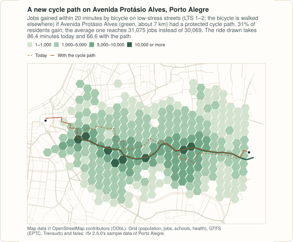

# Example: before and after in Porto Alegre

<!-- docs-test: needs env PEABIRU_EXAMPLE_DATA -->

A transport plan is a list of changes: a cycle path here, a lane taken
from cars there, a new clinic, a fare rule. Each one asks the same
question twice, before and after. In peabiru the street network is built
once, and the changes r5r calls *scenarios* are arguments of each routing
call: `new_lts` changes the level of traffic stress cyclists meet on chosen
streets, `new_carspeeds` and `carspeed_scale` change car speeds by street
or by area, and a fare structure is a dictionary of tables that can be
edited before the call. A new school or clinic is not even a change to the
network: it is one more row among the destinations.

This example asks four such questions of Porto Alegre, on the sample data
that comes with r5r, and times each one: a what-if is one routing call
on the network as built, with nothing to edit and rebuild. The code blocks make one script; the output under
each is what it prints, computed on 2026-11-12, and the numbers are those
of the [R example](../../r/articles/scenarios-porto-alegre.html), whose
figures are drawn from the same results by `site/figures/scenarios.R` in
the repository. The fare routing takes a few minutes. It needs
[geopandas](https://geopandas.org) 1.0 or later.

<figure markdown="span">
  
  <figcaption>Jobs gained by bicycle with a cycle path on Avenida Protásio Alves, computed below.</figcaption>
</figure>

## The data

| Data | Source | Licence |
|---|---|---|
| Streets | OpenStreetMap extract of Porto Alegre in r5r 2.5.0's sample data (`poa_osm.pbf`) | ODbL 1.0, © OpenStreetMap contributors |
| Public transport | The EPTC bus and Trensurb train GTFS feeds of r5r's sample (`poa_eptc.zip`, `poa_trensurb.zip`), cut for the sample: the buses run from 11:20 to 17:50 only, so the analyses below leave at 14:00 on Monday 13 May 2019 | distributed in the r5r package, whose licence line is `GPL (>= 3) \| MIT + file LICENSE` |
| Grid | `poa_hexgrid.csv`: 1,227 H3 cells (resolution 9) with population, jobs, schools and health facilities; r5r does not document its sources | distributed in the r5r package, whose licence line is `GPL (>= 3) \| MIT + file LICENSE` |
| Fares | `fares/fares_poa.zip`, r5r's fare structure of the sample | distributed in the r5r package, whose licence line is `GPL (>= 3) \| MIT + file LICENSE` |

All files come from r5r's repository at the tag of version 2.5.0. The
sample also has an elevation raster, left out here: a call with a scenario
routes without slope costs (as r5r does, with a warning), so the before
and the after would not be comparable. The files are downloaded once into
`PEABIRU_EXAMPLE_DATA`.

```python
import copy
import datetime as dt
import os
import shutil
import time
import urllib.request
from pathlib import Path

import geopandas as gpd
import numpy as np
import pandas as pd
from shapely.geometry import Point

import peabiru

data_dir = Path(os.environ.get("PEABIRU_EXAMPLE_DATA", "example-data")) / "poa"
(data_dir / "network").mkdir(parents=True, exist_ok=True)
(data_dir / "fares").mkdir(exist_ok=True)
url = "https://raw.githubusercontent.com/ipea/r5r/v2.5.0/r-package/inst/extdata/poa/"
for f in ["poa_osm.pbf", "poa_eptc.zip", "poa_trensurb.zip", "poa_hexgrid.csv",
          "fares/fares_poa.zip"]:
    if not (data_dir / f).exists():
        urllib.request.urlretrieve(url + f, data_dir / f)
for f in ["poa_osm.pbf", "poa_eptc.zip", "poa_trensurb.zip"]:
    if not (data_dir / "network" / f).exists():
        shutil.copy(data_dir / f, data_dir / "network" / f)


def timed(f, *args, **kwargs):
    start = time.perf_counter()
    out = f(*args, **kwargs)
    return out, time.perf_counter() - start


threads = 4   # of this laptop's ten cores
network, build_time = timed(peabiru.build_network, data_dir / "network", n_threads=threads)
print(network.info())

grid = pd.read_csv(data_dir / "poa_hexgrid.csv")
grid[["jobs", "healthcare"]] = grid[["jobs", "healthcare"]].fillna(0)   # 5 cells have no count
print(grid[["population", "jobs", "schools", "healthcare"]].sum().astype(int).to_dict())

population = grid.set_index("id")["population"]


def per_resident(table, column="accessibility"):
    """The average of a column of a table with an id column over the residents."""
    w = population.loc[table["id"]].to_numpy()
    return float(np.average(table[column], weights=w))


osm = gpd.read_file(data_dir / "poa_osm.pbf", layer="lines")


def ways_named(name):
    return osm[(osm["name"] == name) & osm["highway"].notna()]
```

```text
{'vertices': 26880, 'edges': 66652, 'elevation': 'NONE', 'feeds': ['poa_trensurb', 'poa_eptc'], 'stops': 4010, 'patterns': 226, 'services': 118, 'frequencies': False}
{'population': 812935, 'jobs': 337921, 'schools': 194, 'healthcare': 141}
```

Building the network takes about a second; every call below is timed the
same way, on a laptop with ten cores, four of them used, and other work running, so the
timings are indications.

## A new cycle path

A cyclist who rides only on streets of low traffic stress (levels 1 and 2
of four, `max_lts=2`, the default) walks the bicycle on the others. In this
extract Avenida Protásio Alves, the radial avenue east of the centre, is
level 4 from end to end. What if it had a protected cycle path? The
scenario gives its OpenStreetMap ways level 1:

```python
ways = ways_named("Avenida Protásio Alves")
path = pd.DataFrame({"osm_id": ways["osm_id"].astype("int64"), "lts": 1})
print(len(path))


def jobs_by_bike(**scenario):
    return peabiru.accessibility(network, grid, grid, opportunities_colnames="jobs",
                                 mode="BICYCLE", max_lts=2, cutoffs=20, n_threads=threads,
                                 **scenario)


before, t_before = timed(jobs_by_bike)
after, t_after = timed(jobs_by_bike, new_lts=path)
gain = before[["id", "accessibility"]].merge(after[["id", "accessibility"]], on="id",
                                             suffixes=("_before", "_after"))
gainers = gain.loc[gain["accessibility_after"] > gain["accessibility_before"], "id"]
print(round(per_resident(gain, "accessibility_before")),
      round(per_resident(gain, "accessibility_after")),
      round(population.loc[gainers].sum() / population.sum(), 3))
```

```text
94
30069 31075 0.312
```

One ride across it, from the east end of the avenue to the Santa Casa
hospital in the centre, before and after:

```python
ends = pd.DataFrame({"id": ["Jardim Carvalho", "Santa Casa"],
                     "lon": [-51.1405, -51.2224], "lat": [-30.0415, -30.03043]})
monday = dt.datetime(2019, 5, 13, 14, 0)


def ride(**scenario):
    return peabiru.detailed_itineraries(network, ends.iloc[[0]], ends.iloc[[1]],
                                        mode="BICYCLE", max_lts=2,
                                        departure_datetime=monday, **scenario)


for when, r in [("today", ride()), ("with the path", ride(new_lts=path))]:
    print(when, r["total_duration"].iloc[0], r["total_distance"].iloc[0])
```

```text
today 86.4 11397
with the path 66.6 9476
```

## Congestion and a closed avenue

peabiru's car speeds are free flow: the speed limit of each street, or a
default by its class, with no traffic. Two scenarios change that: every
street within 2 km of the Mercado Público at half its speed, and Avenida
Ipiranga, the east–west arterial along the Dilúvio creek, closed to cars.

```python
# 16 segments per quarter circle, as st_buffer(nQuadSegs = 16) in the R example
centre = gpd.GeoSeries([Point(-51.22781, -30.02756)], crs=4326).to_crs(31982)
slow_centre = gpd.GeoDataFrame({"poly_id": ["centre"], "scale": [0.5], "priority": [1]},
                               geometry=centre.buffer(2000, quad_segs=16).to_crs(4326))
ipiranga = ways_named("Avenida Ipiranga")
closed = pd.DataFrame({"osm_id": ipiranga["osm_id"].astype("int64"), "max_speed": 0.0,
                       "speed_type": "km/h"})


def drive(**scenario):
    m = peabiru.travel_time_matrix(network, grid, grid, mode="CAR", n_threads=threads,
                                   **scenario)
    return m[["from_id", "to_id", "travel_time_p50"]]


base, t_base = timed(drive)
slow, t_slow = timed(drive, new_carspeeds=slow_centre)
shut, t_shut = timed(drive, new_carspeeds=closed)


def change(scenario):
    m = base.merge(scenario, on=["from_id", "to_id"], how="left", suffixes=("", "_s"))
    after = m["travel_time_p50_s"].astype("float").fillna(120)   # no longer within the limit
    d = after - m["travel_time_p50"].astype("float")
    return float(round(d.mean(), 3)), float(round((d > 0).mean(), 3)), float(d.max())


print(len(base), change(slow), change(shut))
```

```text
1483605 (0.348, 0.143, 9.0) (0.73, 0.137, 119.0)
```

Over all 1,483,605 pairs of cells, the slower centre adds 0.35 minutes on
average and the closed avenue 0.73 (each scenario slows 14% of the pairs;
a pair no longer reached within the two-hour limit counts as 120
minutes): small numbers, because most pairs do not cross either.

Access to health facilities by car, within 10 minutes, on average over the
residents:

```python
def health_by_car(**scenario):
    a = peabiru.accessibility(network, grid, grid, opportunities_colnames="healthcare",
                              mode="CAR", cutoffs=10, n_threads=threads, **scenario)
    return round(per_resident(a), 2)


print(health_by_car(), health_by_car(new_carspeeds=slow_centre),
      health_by_car(new_carspeeds=closed))
```

```text
35.51 32.35 33.43
```

And access to public transport by car: with `mode=["CAR", "TRANSIT"]` a
trip may drive to any stop and board there, or drive all the way. In this
sample the direct drive is always faster, before and after:

```python
some = grid.iloc[::25]


def legs(**scenario):
    e = peabiru.expanded_travel_time_matrix(network, some, some, mode=["CAR", "TRANSIT"],
                                            departure_datetime=monday, time_window=1,
                                            n_threads=threads, **scenario)
    return (e["routes"] != "[CAR]").value_counts().to_dict()


print(legs(), legs(new_carspeeds=slow_centre))
```

```text
{False: 2500} {False: 2500}
```

## One more health facility

Where would one more health facility bring the most people within 15
minutes' walk? Not a network scenario at all: one walking matrix from every
cell to every cell answers it for every candidate site at once.

```python
walk, t_walk = timed(peabiru.travel_time_matrix, network, grid, grid, mode="WALK",
                     max_trip_duration=60, n_threads=threads)
walk["travel_time_p50"] = walk["travel_time_p50"].astype("float")


def nearest(sites):
    w = walk[walk["to_id"].isin(sites)]
    return w.groupby("from_id")["travel_time_p50"].min().reindex(grid["id"])  # NaN: none


has = grid.loc[grid["healthcare"] > 0, "id"]
today = nearest(has)
covered = (today <= 15).to_numpy()

row = pd.Index(grid["id"]).get_indexer(walk["from_id"])
w = walk[(walk["travel_time_p50"] <= 15) & ~covered[row]].copy()
w["people"] = population.loc[w["from_id"]].to_numpy()
best = w.groupby("to_id")["people"].sum().sort_values(ascending=False, kind="stable")
print(best.head(3).round().astype(int).to_dict())


def share_15(t):
    return round(population[t.index[t <= 15]].sum() / population.sum(), 4)


with_one_more = nearest(pd.concat([has, pd.Series([best.index[0]])]))
print(share_15(today), share_15(with_one_more),
      share_15(nearest(grid.loc[grid["schools"] > 0, "id"])))
```

```text
{'89a90129ca7ffff': 17525, '89a90129d73ffff': 17279, '89a90129dcbffff': 17172}
0.7901 0.8117 0.9468
```

The best cell is the one the map of the R example marks. The cells are
hexagons about 350 m across: the search says where to look for a site,
not which plot to buy.

## A change in the fare rules

The sample fare structure charges R$ 4.80 for a bus and R$ 4.50 for the
train; a second bus within an hour brings the pair to R$ 7.20, and only one
transfer per trip is discounted. Two edits: every transfer within the hour
free (two rides cost the dearer fare, up to two discounted transfers), and
no transfer discount at all.

```python
fares = peabiru.read_fare_structure(data_dir / "fares" / "fares_poa.zip")
fare_of = fares["fares_per_type"].set_index("type")["fare"]
free = copy.deepcopy(fares)
t = free["fares_per_transfer"]
t["fare"] = np.maximum(fare_of.loc[t["first_leg"]].to_numpy(), fare_of.loc[t["second_leg"]].to_numpy())
free["max_discounted_transfers"] = 2
none = copy.deepcopy(fares)
none["max_discounted_transfers"] = 0
print(free["fares_per_transfer"])
```

```text
  first_leg second_leg  fare
0       BUS        BUS   4.8
1      RAIL        BUS   4.8
2       BUS       RAIL   4.8
```

The jobs within 45 minutes by public transport, on average over the
residents, with one fare to spend and with R$ 7.20, under each structure;
with a fare structure the multi-criteria router is used, far slower than
the one used without fares. The two are different algorithms and their
travel times differ a little, in both directions, so the reference for the
budgets is the second row: the multi-criteria router with a budget that
never binds. (The difference is R5's: on 103 of these origins r5r 2.5.0
gives the same access as peabiru, origin by origin, with the structure and
without it.)

```python
def jobs_by_transit(**fare_args):
    a, seconds = timed(peabiru.accessibility, network, grid, grid,
                       opportunities_colnames="jobs", mode=["WALK", "TRANSIT"],
                       departure_datetime=monday, time_window=5, cutoffs=45, seed=42,
                       n_threads=threads, **fare_args)
    return round(per_resident(a)), round(seconds, 1)


rows = {"no fare structure": jobs_by_transit(),
        "any budget": jobs_by_transit(fare_structure=fares, max_fare=1000)}
for budget in [4.8, 7.2]:
    for name, structure in [("sample", fares), ("free", free), ("none", none)]:
        rows[f"{name} {budget:.2f}"] = jobs_by_transit(fare_structure=structure, max_fare=budget)
for k, (jobs, seconds) in rows.items():
    print(f"{k:<17} {jobs:>7}")
```

```text
no fare structure  196273
any budget         196456
sample 4.80        159996
free 4.80          196375
none 4.80          159996
sample 7.20        192062
free 7.20          196375
none 7.20          159996
```

For one trip, [`trip_options()`][peabiru.trip_options] lists the options
worth considering, here by travel time and fare:

```python
pair = grid.set_index("id").loc[["89a90129d93ffff", "89a9012b12fffff"]].reset_index()


def options_under(structure):
    o = peabiru.trip_options(network, pair.iloc[[0]], pair.iloc[[1]],
                             departure_datetime=monday, criteria=["TIME", "FARE"],
                             fare_structure=structure, itineraries=False).options
    return o[["option", "total_time", "fare", "transfers", "departure_time", "description"]]


print(options_under(fares).to_string(index=False))
print(options_under(free).to_string(index=False))
```

```text
 option  total_time  fare  transfers departure_time                              description
      1        48.6  12.0          2       14:00:00 WALK > BUS 493 > BUS T7 > BUS 289 > WALK
      2        52.5   7.2          1       14:09:00          WALK > BUS 441 > BUS 260 > WALK
      3        53.5   7.2          1       14:08:00           WALK > BUS T7 > BUS 260 > WALK
      4        54.5   7.2          1       14:07:00           WALK > BUS T7 > BUS 260 > WALK
      5        58.5   7.2          1       14:03:00          WALK > BUS 495 > BUS 260 > WALK
      6        59.5   7.2          1       14:02:00          WALK > BUS 494 > BUS 260 > WALK
      7        61.5   7.2          1       14:00:00          WALK > BUS 491 > BUS 260 > WALK
      8        82.2   4.8          0       14:09:00                   WALK > BUS 2802 > WALK
      9        87.2   4.8          0       14:04:00                   WALK > BUS 2802 > WALK
     10        91.2   4.8          0       14:00:00                   WALK > BUS 2802 > WALK
 option  total_time  fare  transfers departure_time                              description
      1        48.6   4.8          2       14:00:00 WALK > BUS 493 > BUS T7 > BUS 289 > WALK
      2        52.5   4.8          1       14:09:00         WALK > BUS 2802 > BUS 260 > WALK
      3        57.5   4.8          1       14:04:00         WALK > BUS 2802 > BUS 260 > WALK
```

Under the sample rules, the 49-minute trip with three buses costs R$ 12.00
and the fastest at one fare is a single bus at 82 minutes; with free
transfers, the 49-minute trip costs one fare.

## What each what-if cost

Every scenario above was one routing call on the network built once, at
the start; none rebuilt it. A call with a street scenario searches the
network directly, without the contraction hierarchies peabiru keeps for
repeated street matrices, so it can take longer than the same call
without one. The timings vary with the machine, so this page does not
print them; the R example prints the ones of the run that drew the
figures, and `build_time`, `t_before`, `t_after`, `t_base`, `t_slow`,
`t_shut` and `t_walk` above hold this run's.

Map data © OpenStreetMap contributors, under the ODbL; GTFS feeds, grid and
fare structure as distributed with r5r 2.5.0.
