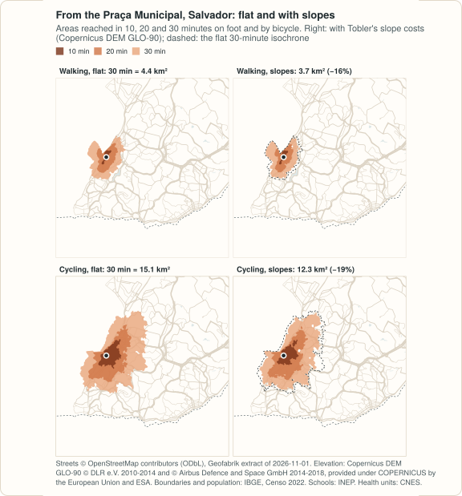

# Example: cities of hills, Salvador and Olinda

<!-- docs-test: needs osmium, gdalwarp, env PEABIRU_EXAMPLE_DATA -->

What do slopes change in walking and cycling times? This example builds two
cities of hills, **Salvador** (Bahia, 2.4 million people in the Censo 2022,
a city split by an escarpment between its upper and lower towns) and
**Olinda** (Pernambuco, 350 thousand, a historic centre on hills next to a
flat coastal strip), each twice: on flat ground, and with an elevation
raster from the Copernicus DEM (GLO-90, 3 arc seconds), with Tobler's hiking
function and with Minetti's energy cost. Then it measures the areas reached from the centre
and the time from every resident to the nearest public school and primary
health care unit.

The code blocks make one script; the output shown under each block is what
it prints, computed on 2026-11-12. It repeats, step by step, the cities of
hills of the [R example](../../r/articles/terrain.html), and prints the same
numbers; the R example also covers the Recife metropolitan region and five
more municipalities of Pernambuco, and compares GLO-90 with GLO-30 (see
[Which raster](#which-raster) below). It needs
[geopandas](https://geopandas.org) 1.0 or later and two command-line tools:
[osmium](https://osmcode.org/osmium-tool/) to cut the street extract and
GDAL's `gdalwarp` to cut the elevation model (`brew install osmium-tool
gdal`, `apt install osmium-tool gdal-bin`, or conda-forge).

<figure markdown="span">
  
  <figcaption>From the Praça Municipal, on foot and by bicycle, flat and with slopes, computed below; drawn by <code>site/figures/terrain.R</code> in the repository.</figcaption>
</figure>

!!! note "Streets only"
    No open GTFS feed was found for Salvador or for the Recife metropolitan
    region (Grande Recife Consórcio de Transporte, CBTU): neither state has a
    feed in the Mobility Database, and the agencies' portals publish none.
    So this example routes on the streets.

## The data

| Data | Source | Licence |
|---|---|---|
| Streets | [OpenStreetMap](https://www.openstreetmap.org/copyright), extract of the Nordeste region by [Geofabrik](https://download.geofabrik.de/south-america/brazil/nordeste.html), dated 2026-11-01 (445 MB, MD5 `93318fcddd85a53e8386eaa93588847c`) | ODbL 1.0 |
| Elevation | [Copernicus DEM GLO-90](https://registry.opendata.aws/copernicus-dem/) (2021 release; files of 2022-05-09), a surface model at 3 arc seconds (about 90 m), read from its tiles on the AWS open data registry on 2026-11-12 | [Copernicus DEM licence](https://dataspace.copernicus.eu/explore-data/data-collections/copernicus-contributing-missions/collections-description/COP-DEM): free use with attribution |
| Municipal boundaries | [IBGE, malhas municipais](https://servicodados.ibge.gov.br/api/docs/malhas?versao=3) (API, version 3) | public data, IBGE |
| Population | [IBGE, Censo Demográfico 2022, census tracts with their population](https://ftp.ibge.gov.br/Censos/Censo_Demografico_2022/Agregados_por_Setores_Censitarios/malha_com_atributos/setores/gpkg/UF/), variable `v0001`, files of Pernambuco (44 MB) and Bahia (118 MB) | public data, IBGE |
| Schools | INEP, Catálogo de Escolas 2023, with the coordinates of each school, as published by Ipea's [geobr](https://ipeagit.github.io/geobr/) (`schools_2023`, 101 MB for Brazil) | public data, INEP; geobr is MIT |
| Health units | [CNES](https://cnes.datasus.gov.br/), Ministério da Saúde, through [OpenDataSUS](https://opendatasus.saude.gov.br/) (`cnes_estabelecimentos_csv.zip`, 57 MB for Brazil, updated daily; downloaded on 2026-11-12) | open data, Ministério da Saúde |

```python
import gzip
import math
import os
import shutil
import subprocess
import urllib.request
import zipfile
from pathlib import Path

import geopandas as gpd
import numpy as np
import pandas as pd
from shapely.geometry import Polygon

import peabiru

data_dir = Path(os.environ.get("PEABIRU_EXAMPLE_DATA", "terrain-data"))
raw = data_dir / "raw"
raw.mkdir(parents=True, exist_ok=True)


def fetch(url, name=None):
    dest = raw / (name or url.rsplit("/", 1)[1])
    if not dest.exists():
        part = dest.with_suffix(".part")
        with urllib.request.urlopen(url) as response, open(part, "wb") as out:
            # IBGE's API sends its answer gzip-compressed, asked or not
            gz = response.headers.get("Content-Encoding") == "gzip"
            shutil.copyfileobj(gzip.GzipFile(fileobj=response) if gz else response, out)
        part.rename(dest)
    return dest


tracts_url = ("https://ftp.ibge.gov.br/Censos/Censo_Demografico_2022/"
              "Agregados_por_Setores_Censitarios/malha_com_atributos/setores/gpkg/UF/{0}/"
              "{0}_setores_CD2022.gpkg")
nordeste = fetch("https://download.geofabrik.de/south-america/brazil/nordeste-261101.osm.pbf")
tracts_file = {uf: fetch(tracts_url.format(uf)) for uf in ["BA", "PE"]}
schools_file = fetch("https://www.ipea.gov.br/geobr/data_gpkg/schools/2023/schools_2023.gpkg")
cnes_file = fetch("https://s3.sa-east-1.amazonaws.com/ckan.saude.gov.br/CNES/"
                  "cnes_estabelecimentos_csv.zip")

# IBGE code, state, metres around the municipality, cell spacing, UTM zone
# (SIRGAS 2000 / UTM 24S and 25S), and the point the isochrones start from
cities = pd.DataFrame({
    "key": ["salvador", "olinda"], "code": ["2927408", "2609600"],
    "uf": ["BA", "PE"], "uf_code": ["29", "26"], "buffer": [3000, 3000],
    "spacing": [500, 250], "utm": [31984, 31985],
    "origin": ["Praça Municipal", "Alto da Sé"],
    "lon": [-38.5128, -34.8408], "lat": [-12.9740, -8.0136],
}).set_index("key")
```

## Streets and elevation

The streets are cut from the regional extract with the municipality and 3 km
around it, as in the [Recife and Caruaru example](example-recife-caruaru.md).
The elevation model is cut over the box of those streets: GDAL reads only
the parts of the Copernicus tiles it needs, straight from the AWS registry,
and the crop keeps the tiles' own grid (no resampling). The sea has no
tiles; the documentation of the registry says to take it as 0 m, which
`INIT_DEST=0` does. The extract goes in two directories: `network/` alone, and
`network-dem/` with the raster, which turns slope costs on.

```python
dem_url = ("https://copernicus-dem-90m.s3.amazonaws.com/Copernicus_DSM_COG_30_{0}_00_{1}_00_DEM/"
           "Copernicus_DSM_COG_30_{0}_00_{1}_00_DEM.tif")


def boundary_of(code, utm):
    url = ("https://servicodados.ibge.gov.br/api/v3/malhas/municipios/" + code +
           "?formato=application/vnd.geo+json&qualidade=maxima")
    b = gpd.read_file(fetch(url, f"{code}.geojson"))
    return b.to_crs(utm).make_valid()


def cut_streets(key, boundary, buffer):
    folder = data_dir / key / "network"
    folder.mkdir(parents=True, exist_ok=True)
    polygon = data_dir / key / "cut.geojson"
    # 30 segments per quarter circle, as sf's st_buffer()
    gpd.GeoSeries(boundary.buffer(buffer, quad_segs=30)).to_crs(4326).to_file(polygon)
    pbf = folder / f"{key}.osm.pbf"
    subprocess.run(["osmium", "extract", "--overwrite", "-p", str(polygon),
                    str(nordeste), "-o", str(pbf)], check=True)
    return pbf


def exists(url):
    try:
        with urllib.request.urlopen(urllib.request.Request(url, method="HEAD")):
            return True
    except OSError:
        return False


def cut_dem(key, pbf):
    folder = data_dir / key / "network-dem"
    folder.mkdir(exist_ok=True)
    if not (folder / pbf.name).exists():
        os.link(pbf, folder / pbf.name)
    # the box of the extract's streets, not of the cut: osmium keeps whole the
    # ways that cross the cut, and peabiru takes points off the raster as 0 m
    streets = folder / "streets.osm.pbf"
    subprocess.run(["osmium", "tags-filter", "--overwrite", str(pbf), "w/highway",
                    "-o", str(streets)], check=True)
    box = subprocess.run(["osmium", "fileinfo", "-e", "-g", "data.bbox", str(streets)],
                         check=True, capture_output=True, text=True).stdout
    streets.unlink()
    xmin, ymin, xmax, ymax = (float(v) for v in box.strip("()\n").split(","))
    px = 3 / 3600   # pixels centred on the 3-arc-second grid: edges half a pixel off
    te = [(math.floor(xmin / px - 0.5) + 0.5) * px, (math.floor(ymin / px - 0.5) + 0.5) * px,
          (math.ceil(xmax / px - 0.5) + 0.5) * px, (math.ceil(ymax / px - 0.5) + 0.5) * px]
    tiles = []
    for lat in range(math.floor(te[1]), math.floor(te[3]) + 1):
        for lon in range(math.floor(te[0]), math.floor(te[2]) + 1):
            ns = f"{'S' if lat < 0 else 'N'}{abs(lat):02d}"
            ew = f"{'W' if lon < 0 else 'E'}{abs(lon):03d}"
            if exists(dem_url.format(ns, ew)):
                tiles.append("/vsicurl/" + dem_url.format(ns, ew))
    tif = folder / f"{key}_dem.tif"
    subprocess.run(["gdalwarp", "-q", "-overwrite", "-of", "GTiff", *tiles, str(tif),
                    "-te", *[f"{v:.10f}" for v in te], "-tr", f"{px:.15f}", f"{px:.15f}",
                    "-r", "near", "-wo", "INIT_DEST=0", "-ot", "Float32",
                    "-co", "COMPRESS=DEFLATE", "-co", "PREDICTOR=3", "-co", "TILED=YES"],
                   check=True)
    return len(tiles), tif


boundaries = {}
for key, c in cities.iterrows():
    boundaries[key] = boundary_of(c["code"], c["utm"])
    pbf = cut_streets(key, boundaries[key].geometry, c["buffer"])
    n, tif = cut_dem(key, pbf)
    print(f"{key:8} streets {pbf.stat().st_size / 1e6:5.1f} MB, "
          f"elevation {n} tiles, {tif.stat().st_size / 1e6:4.1f} MB")
```

```text
salvador streets   9.0 MB, elevation 2 tiles,  0.3 MB
olinda   streets   3.4 MB, elevation 2 tiles,  0.1 MB
```

### Which raster

The Copernicus DEM is a surface model: it measures the top of whatever the
radar saw, buildings and trees included. At 1 arc second (GLO-30, the same
address with `30m` and `COG_10`) a street between towers reads metres above
its neighbour, and since peabiru samples the raster every 10 m along each
street, at the nearest pixel, those steps become slopes. The
[R example](../../r/articles/terrain.html#the-elevation-model-checked-against-the-ground)
measures it on a flat district of towers in Recife, where slopes should
cost nothing: GLO-30 adds a minute to the average walk to a health unit,
GLO-90 0.15 of a minute. So this example uses GLO-90, which averages the
roofs away, and with them the short steep streets: its slope costs are on
the low side. A terrain model (bare earth) at a finer resolution, where one
exists, is the better input.

## Where people live, and the units

A hexagonal grid with the population of the census tracts (500 m apart in
Salvador, 250 m in the small municipality of Olinda), public schools from
INEP and primary health care units from CNES, over the cut area, as in the
Recife and Caruaru example.

```python
def hex_grid(area, spacing):
    xmin, ymin, xmax, ymax = area.total_bounds
    h = spacing * np.sqrt(3) / 2
    r = spacing / np.sqrt(3)
    k = np.radians(30 + 60 * np.arange(7))   # pointy side up
    cells = []
    for j in range(-1, int(np.ceil((ymax - ymin) / h)) + 2):
        for i in range(-1, int(np.ceil((xmax - xmin) / spacing)) + 2):
            x = xmin + i * spacing + (j % 2) * spacing / 2
            y = ymin + j * h
            cells.append(Polygon(zip(x + r * np.cos(k), y + r * np.sin(k))))
    cells = gpd.GeoSeries(cells, crs=area.crs)
    cells = cells[cells.intersects(area.union_all())].reset_index(drop=True)
    return gpd.GeoDataFrame({"id": np.arange(1, len(cells) + 1)}, geometry=cells)


def population_grid(c, boundary):
    tracts = gpd.read_file(tracts_file[c["uf"]], where=f"CD_MUN = '{c['code']}'",
                           columns=["v0001"])
    tracts = tracts.to_crs(c["utm"])
    tracts["geometry"] = tracts.make_valid()
    tracts["tract_area"] = tracts.area
    cells = hex_grid(boundary, c["spacing"])
    parts = gpd.overlay(cells, tracts, how="intersection", keep_geom_type=True)
    parts["people"] = parts["v0001"] * parts.area / parts["tract_area"]
    cells["population"] = cells["id"].map(parts.groupby("id")["people"].sum()).fillna(0)
    centres = cells.centroid.to_crs(4326)
    cells["lon"], cells["lat"] = centres.x.round(6), centres.y.round(6)
    cells["id"] = cells["id"].astype(str)
    return cells[cells["population"] > 0]


def schools_in(area):
    s = gpd.read_file(
        schools_file, bbox=area.bounds,
        columns=["code_school", "name_school", "name_muni"],
        where="admin_category = 'Pública' AND service_restriction = "
              "'ESCOLA EM FUNCIONAMENTO E SEM RESTRIÇÃO DE ATENDIMENTO'",
    )
    s = s[~s.geometry.is_empty & s.intersects(area)]
    return pd.DataFrame({"id": s["code_school"].astype(str), "lon": s.geometry.x,
                         "lat": s.geometry.y}).reset_index(drop=True)


with zipfile.ZipFile(cnes_file) as z, z.open("cnes_estabelecimentos.csv") as f:
    cnes = pd.read_csv(f, sep=";", encoding="cp1252", dtype=str, keep_default_na=False,
                       usecols=["CO_CNES", "CO_UF", "TP_UNIDADE", "CO_MOTIVO_DESAB",
                                "NU_LATITUDE", "NU_LONGITUDE"])
cnes = cnes[cnes["TP_UNIDADE"].isin(["1", "2"]) & (cnes["CO_MOTIVO_DESAB"] == "")
            & (cnes["NU_LATITUDE"] != "") & (cnes["NU_LONGITUDE"] != "")]


def health_in(area, uf_code):
    h = cnes[cnes["CO_UF"] == uf_code]
    h = pd.DataFrame({"id": h["CO_CNES"], "lon": h["NU_LONGITUDE"].astype(float),
                      "lat": h["NU_LATITUDE"].astype(float)})
    inside = gpd.GeoSeries(gpd.points_from_xy(h["lon"], h["lat"])).intersects(area).values
    return h[inside].reset_index(drop=True)


grids, schools, health = {}, {}, {}
for key, c in cities.iterrows():
    area = gpd.read_file(data_dir / key / "cut.geojson").to_crs(4674).union_all()
    grids[key] = population_grid(c, boundaries[key])
    schools[key] = schools_in(area)
    health[key] = health_in(area, c["uf_code"])
    print(f"{key:8} {len(grids[key]):5} cells, {grids[key]['population'].sum():,.0f} people, "
          f"{len(schools[key])} schools, {len(health[key])} health units")
```

```text
salvador  1567 cells, 2,418,518 people, 652 schools, 202 health units
olinda     857 cells, 349,970 people, 260 schools, 160 health units
```

## Networks: flat, Tobler and Minetti

```python
networks = {}
for key in cities.index:
    networks[key, "NONE"] = peabiru.build_network(data_dir / key / "network")
    for model in ["TOBLER", "MINETTI"]:
        networks[key, model] = peabiru.build_network(data_dir / key / "network-dem",
                                                     elevation=model)
    print(key, networks[key, "TOBLER"].info()["elevation"],
          networks[key, "TOBLER"].info()["edges"])
```

```text
salvador TOBLER 188750
olinda TOBLER 69998
```

## Isochrones from the centre

The area reached in 30 minutes from the Praça Municipal, on the edge of
Salvador's escarpment, and from the Alto da Sé, on Olinda's hill, in square
kilometres:

```python
rows = []
for key, c in cities.iterrows():
    centre = pd.DataFrame({"id": [c["origin"]], "lon": [c["lon"]], "lat": [c["lat"]]})
    for mode in ["WALK", "BICYCLE"]:
        for model in ["NONE", "TOBLER", "MINETTI"]:
            iso = peabiru.isochrone(networks[key, model], centre, mode=mode,
                                    cutoffs=[10, 20, 30], zoom=11)
            # made valid in metres before measuring (see the Recife example)
            km2 = iso.to_crs(c["utm"]).make_valid().area / 1e6
            rows += [[key, mode, model, int(m), round(a, 2)]
                     for m, a in zip(iso["isochrone"], km2)]
iso = pd.DataFrame(rows, columns=["city", "mode", "elevation", "minutes", "km2"])
print(iso[iso["minutes"] == 30].pivot_table(index=["city", "mode"], columns="elevation",
                                             values="km2")[["NONE", "TOBLER", "MINETTI"]])
```

```text
elevation          NONE  TOBLER  MINETTI
city     mode                           
olinda   BICYCLE  15.05   13.95    12.43
         WALK      5.10    4.65     3.95
salvador BICYCLE  15.13   12.28     8.49
         WALK      4.40    3.69     2.89
```

With Tobler's hiking function the slopes take 16% of the area reached on
foot from the Praça Municipal and 19% of the area reached by bicycle; from
the Alto da Sé, 9% and 7%. Minetti's energy cost takes more than twice as
much.
The Elevador Lacerda, next to the Praça Municipal, is not a street and is
not in the network.

## Time to the nearest school and health unit

```python
def nearest(key, model, mode, max_lts=2):
    out = grids[key][["id", "lon", "lat", "population"]].copy()
    for what, units in [("schools", schools[key]), ("health", health[key])]:
        m = peabiru.travel_time_matrix(networks[key, model], out, units, mode=mode,
                                       max_lts=max_lts, max_trip_duration=60)
        out[what] = out["id"].map(m.groupby("from_id")["travel_time_p50"].min())
    return out                                  # NaN: none within the hour


def share(t, what, minutes=15):
    return round(100 * t["population"][t[what] <= minutes].sum() / t["population"].sum(), 1)


def mean_minutes(t, what="health"):
    ok = t[what].notna()
    return round(np.average(t[what][ok], weights=t["population"][ok]), 2)


rows = []
for key in cities.index:
    for mode in ["WALK", "BICYCLE"]:
        for model in ["NONE", "TOBLER", "MINETTI"]:
            t = nearest(key, model, mode)
            rows.append([key, mode, model, share(t, "schools"), share(t, "health"),
                         mean_minutes(t)])
table = pd.DataFrame(rows, columns=["city", "mode", "elevation", "school_15", "health_15",
                                    "mean_health"])
print(table.to_string(index=False))
```

```text
    city    mode elevation  school_15  health_15  mean_health
salvador    WALK      NONE       86.8       60.7        15.09
salvador    WALK    TOBLER       84.1       56.4        16.18
salvador    WALK   MINETTI       76.7       49.2        17.84
salvador BICYCLE      NONE       96.4       88.9         7.81
salvador BICYCLE    TOBLER       95.7       86.8         8.49
salvador BICYCLE   MINETTI       94.4       83.4         9.66
  olinda    WALK      NONE       90.0       75.8        11.20
  olinda    WALK    TOBLER       88.2       74.6        11.67
  olinda    WALK   MINETTI       85.6       71.8        12.53
  olinda BICYCLE      NONE      100.0       99.0         4.14
  olinda BICYCLE    TOBLER       99.9       98.9         4.29
  olinda BICYCLE   MINETTI       99.5       98.8         4.61
```

`school_15` and `health_15` are the share of the residents (in %) within 15
minutes of the nearest public school and primary health care unit;
`mean_health`, the average time to the health unit, in minutes, over those
who reach one within the hour with that model, so the rows of a city are
not over exactly the same cells. On foot in Salvador the average goes from
15.1 minutes to 16.2 with Tobler and 17.8 with Minetti (cell by cell, over
those that reach a unit both ways, Tobler adds 1.26 minutes), and the
residents within 15 minutes of a health unit go from 60.7% to 56.4% and
49.2%. Olinda, mostly
flat, loses less than half of that.

## Traffic stress and slope

```python
rows = []
for key in cities.index:
    for lts in [1, 2, 3, 4]:
        flat = nearest(key, "NONE", "BICYCLE", max_lts=lts)
        hill = nearest(key, "TOBLER", "BICYCLE", max_lts=lts)
        rows.append([key, lts, mean_minutes(flat), mean_minutes(hill)])
print(pd.DataFrame(rows, columns=["city", "max_lts", "flat", "slopes"]).to_string(index=False))
```

```text
    city  max_lts  flat  slopes
salvador        1  8.75    9.51
salvador        2  7.81    8.49
salvador        3  7.53    8.20
salvador        4  5.34    5.81
  olinda        1  4.98    5.19
  olinda        2  4.14    4.29
  olinda        3  4.12    4.27
  olinda        4  3.45    3.58
```

The average cycling time to the nearest health unit, in minutes, by the
highest level of traffic stress ridden (`max_lts`; 2 is the default, and on
a street above it the bicycle is walked). Stress costs more than slope:
riding any street instead of calm streets only saves 3.4 minutes in
Salvador, and the slopes add 0.5 to 0.8.

## Variations

- **Another city.** Add a row to `cities`: the IBGE code, the state of the
  census tracts and of the CNES rows, a UTM zone, and the Geofabrik region.
- **Another elevation model.** Any GeoTIFF in WGS 84 or one of the systems
  listed in [`build_network()`](reference.md#peabiru.build_network) works:
  put it in `network-dem/` instead. A bare-earth terrain model, such as a
  city's own LiDAR survey, avoids the roofs.
- **The slope costs alone.** `travel_time_matrix()` on the networks with
  and without the raster, from the same points, gives the minutes the slopes
  add to each trip.

Map data © OpenStreetMap contributors, under the ODbL; elevation:
Copernicus DEM GLO-90 © DLR e.V. 2010-2014 and © Airbus Defence and Space
GmbH 2014-2018, provided under COPERNICUS by the European Union and ESA;
boundaries and population © IBGE; schools: INEP (Catálogo de Escolas 2023,
via geobr); health units: CNES, Ministério da Saúde.
