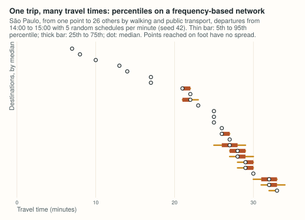
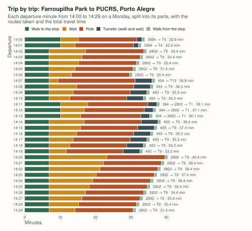

# Example: how much a trip by public transport varies

By car or on foot, a trip takes the same time whenever it starts. By public
transport it does not: it depends on when the next vehicle leaves. This
example measures that variation in two ways, with percentiles over a window
of departures, and trip by trip. The code blocks make one script; the output
shown under each is what it prints.

## Percentiles on a frequency-based network

The São Paulo sample that ships with the package has a feed described by
frequencies ("a bus every 8 minutes") rather than timetables. For such
routes peabiru draws random schedules consistent with the frequencies, 5 per
departure minute by default, so the travel times of a window of departures
form a distribution. `seed` makes the draws reproducible.

```python
import datetime as dt

import peabiru

network = peabiru.build_network(peabiru.sample_data_path())
points = peabiru.sample_points()
monday = dt.datetime(2019, 5, 13, 14, 0)

ttm = peabiru.travel_time_matrix(
    network, points.iloc[:1], points.iloc[1:],
    mode=["WALK", "TRANSIT"],
    departure_datetime=monday,
    time_window=60,
    percentiles=[5, 25, 50, 75, 95],
    seed=42,
)
ttm = ttm.sort_values(["travel_time_p50", "travel_time_p95"], ignore_index=True)
print(ttm.drop(columns="from_id").iloc[::5].to_string())
```

```text
              to_id  travel_time_p05  travel_time_p25  travel_time_p50  travel_time_p75  travel_time_p95
0   89a8100c007ffff                7                7                7                7                7
5   89a8100c02bffff               17               17               17               17               17
10  89a8100c0afffff               23               23               23               23               23
15  89a8100c397ffff               26               26               26               27               27
20  89a8100c14bffff               28               29               29               30               30
25  89a8100c38bffff               32               33               33               33               33
```

The destinations closest to the origin are walked to, and every departure
takes the same time. Further away, a bus or the metro saves time, and the
spread between the 5th and 95th percentiles is the price of not knowing when
it comes:

<figure markdown="span">
  
  <figcaption>The percentiles computed above, drawn by <code>site/figures/figures.R</code> in the repository.</figcaption>
</figure>

## Trip by trip

[`expanded_travel_time_matrix()`](reference.md#peabiru.expanded_travel_time_matrix)
keeps one row per departure minute (and per draw, on a frequency-based
network) instead of percentiles. With `breakdown=True`, each trip is split
into its parts, and the routes taken are listed. Here, from Farroupilha Park
to the PUCRS university campus in Porto Alegre, whose sample data (from the r5r
project) has bus timetables:

```python
import tempfile
import urllib.request
from pathlib import Path

import pandas as pd

poa = Path(tempfile.gettempdir()) / "peabiru-poa"
poa.mkdir(exist_ok=True)
url = "https://raw.githubusercontent.com/ipea/r5r/v2.5.0/r-package/inst/extdata/poa/"
for name in ["poa_osm.pbf", "poa_eptc.zip", "poa_trensurb.zip",
             "poa_points_of_interest.csv"]:
    if not (poa / name).exists():
        urllib.request.urlretrieve(url + name, poa / name)

poa_network = peabiru.build_network(poa)
poi = pd.read_csv(poa / "poa_points_of_interest.csv")

trips = peabiru.expanded_travel_time_matrix(
    poa_network,
    poi[poi["id"] == "farroupilha_park"],
    poi[poi["id"] == "pucrs"],
    mode=["WALK", "TRANSIT"],
    departure_datetime=monday,
    time_window=30,
    breakdown=True,
)
cols = ["departure_time", "access_time", "wait_time", "ride_time",
        "transfer_time", "egress_time", "routes", "total_time"]
print(trips[cols].head(10).to_string())
```

```text
  departure_time  access_time  wait_time  ride_time  transfer_time  egress_time   routes  total_time
0       14:00:00         10.1        5.1       16.5            1.4          0.8  3984|T4        33.9
1       14:01:00         10.1        4.1       16.5            1.4          0.8  3984|T4        32.9
2       14:02:00          6.9       10.3       16.4            0.0          0.8  2802|T9        34.4
3       14:03:00          6.9        9.3       16.4            0.0          0.8  2802|T9        33.4
4       14:04:00          6.9        8.3       16.4            0.0          0.8  2802|T9        32.4
5       14:05:00          6.9        7.3       16.4            0.0          0.8  2802|T9        31.4
6       14:06:00          6.9        6.3       16.4            0.0          0.8  2802|T9        30.4
7       14:07:00          6.9        2.5       21.8            4.8          0.8  494|T12        36.8
8       14:08:00          6.9        7.8       16.1            4.7          0.8   493|T9        36.3
9       14:09:00          6.9        6.8       16.1            4.7          0.8   493|T9        35.3
```

Leaving at 14:02 or at 14:20, the trip uses the same two lines; what
changes is the wait. At 14:07 a different pair of buses wins. Over the
whole half hour:

```python
print(trips.groupby("routes")["total_time"].agg(["count", "min", "max"]))
```

```text
             count   min   max
routes                        
2802|T9         15  30.4  40.4
394|2802|T1      3  36.1  38.1
3984|T4          2  32.9  33.9
493|T9           9  33.3  38.4
494|T12          1  36.8  36.8
```

<figure markdown="span">
  
  <figcaption>The trips computed above, drawn by <code>site/figures/figures.R</code> in the repository.</figcaption>
</figure>

## Variations

- **Arrive by.** [`arrival_travel_time_matrix()`](expanded-arrival.md#arrival-matrices)
  answers the reverse question: the latest departure that arrives by a given
  time.
- **Fewer transfers.** `max_rides=1` keeps only the trips with a single
  vehicle; compare the totals.
- **More draws.** `draws_per_minute` sets how many random schedules are
  drawn per minute on frequency-based routes.
