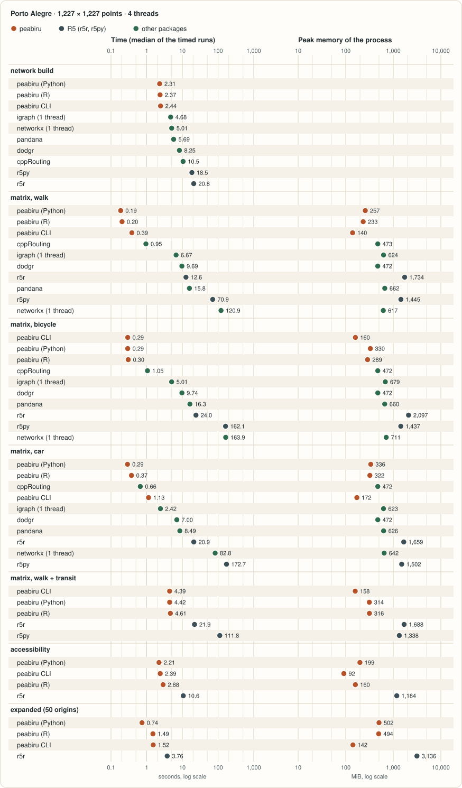
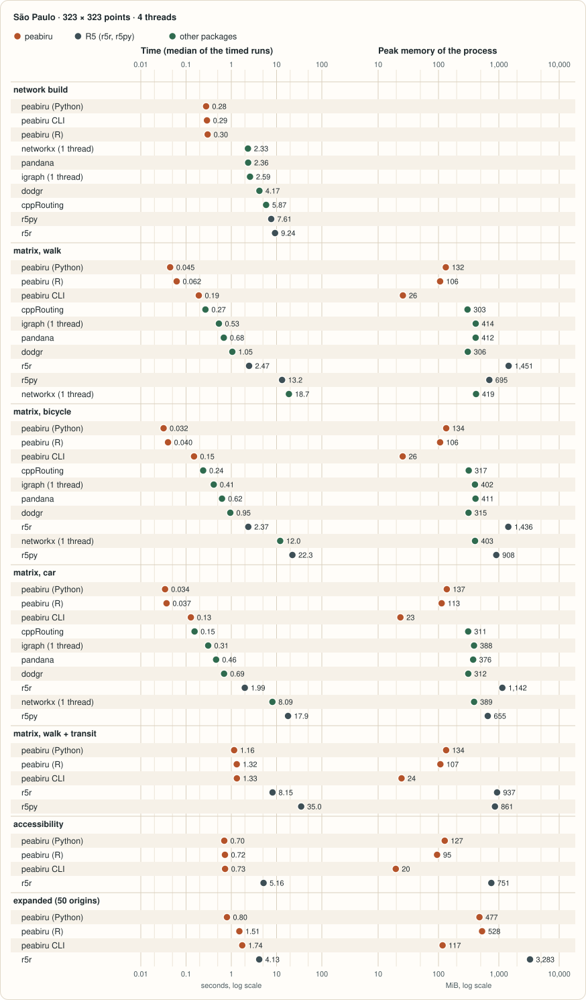
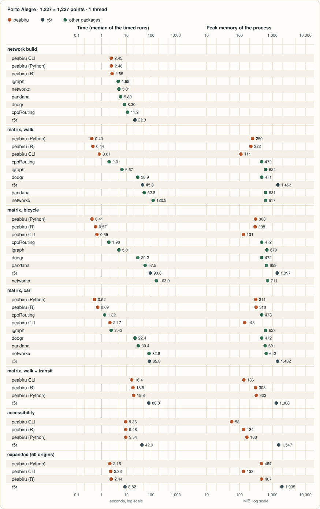
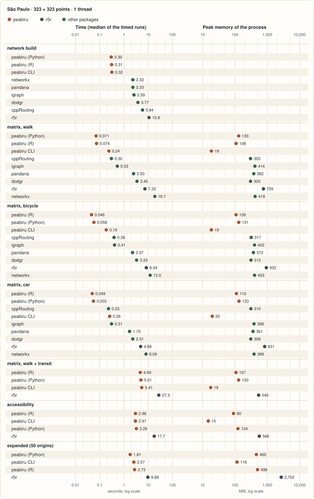

# Benchmarks

How long peabiru takes, and how much memory it uses, next to the
packages people use for travel-time matrices from R and Python: r5r and
r5py, which run the same model as peabiru, and dodgr, cppRouting,
networkx, igraph and pandana, which route streets with models of their
own. Every number on this page is read from `site/data/benchmarks.csv`
in the repository, written by `bench/site/run.py`; the methodology, the
charts and the reasons why each package’s answers differ are on the
[benchmarks page of the main site](../../benchmarks.md).

The run was made in a container with a limited number of CPUs on a
shared server, so read the times as a comparison between packages within
one run; the date and the machine are listed below.

Measured on 2026-11-12, Intel(R) Xeon(R) CPU E5-2699 v4 @ 2.20GHz (8
cores, 31.3 GiB RAM), in a container limited to 4 CPUs and 10 GiB, load
average 1.45 when the run started; peabiru commit `061129a`.

- **peabiru CLI**: peabiru 0.0.1
- **peabiru (R)**: peabiru 0.0.1 (core 0.0.1)
- **peabiru (Python)**: peabiru 0.0.1 (Python)
- **r5r**: r5r 2.5.0 (R5 7.6)
- **r5py**: r5py 1.1.7 (R5 7.5.1-r5py)
- **dodgr**: dodgr 0.5.0 (osmdata 0.4.1)
- **cppRouting**: cppRouting 3.2 (dodgr 0.5.0, osmdata 0.4.1)
- **networkx**: networkx 3.7 (pyrosm 0.29.0, osmnx 2.1.1)
- **igraph**: igraph 1.0.0 (pyrosm 0.29.0, osmnx 2.1.1, networkx 3.7)
- **pandana**: pandana 0.8 (pyrosm 0.29.0, osmnx 2.1.1, networkx 3.7)

## Summary

- **matrix, walk + transit**, Porto Alegre, 4 threads: peabiru (R) 4.61
  s and 316 MiB; 2 other packages 21.94 to 111.85 s (r5r, r5py).
- **matrix, walk**, Porto Alegre, 4 threads: peabiru (R) 0.20 s and 233
  MiB; 7 other packages 0.95 to 120.85 s (cppRouting, igraph, dodgr,
  r5r, pandana, r5py, networkx).

Only r5r and r5py compute the same matrices as peabiru; for the street
packages the tables below also show how far their answers are from
peabiru’s.

## All tasks



bench-poa-t4



bench-spo-t4



bench-poa-t1



bench-spo-t1

### Porto Alegre, 4 threads

| task | package | seconds | peak MiB | pairs both | only peabiru | only package | median abs. diff. (min) | p90 abs. diff. (min) |
|:---|:---|:---|:---|:---|:---|:---|:---|:---|
| network build | peabiru (Python) | 2.309 |  |  |  |  |  |  |
| network build | peabiru (R) | 2.369 |  |  |  |  |  |  |
| network build | peabiru CLI | 2.445 |  |  |  |  |  |  |
| network build | igraph (1 thread) | 4.684 |  |  |  |  |  |  |
| network build | networkx (1 thread) | 5.012 |  |  |  |  |  |  |
| network build | pandana | 5.688 |  |  |  |  |  |  |
| network build | dodgr | 8.254 |  |  |  |  |  |  |
| network build | cppRouting | 10.479 |  |  |  |  |  |  |
| network build | r5py | 18.503 |  |  |  |  |  |  |
| network build | r5r | 20.834 |  |  |  |  |  |  |
| matrix, walk | peabiru (Python) | 0.186 | 257 | 788,682 | 0 | 0 | 0.0 | 0.0 |
| matrix, walk | peabiru (R) | 0.204 | 233 | 788,682 | 0 | 0 | 0.0 | 0.0 |
| matrix, walk | peabiru CLI | 0.385 | 140 |  |  |  |  |  |
| matrix, walk | cppRouting | 0.949 | 473 | 731,379 | 57,303 | 18,558 | 2.6 | 8.9 |
| matrix, walk | igraph (1 thread) | 6.668 | 624 | 784,468 | 4,214 | 32,593 | 1.4 | 4.1 |
| matrix, walk | dodgr | 9.694 | 472 | 731,351 | 57,331 | 18,554 | 2.6 | 8.9 |
| matrix, walk | r5r | 12.611 | 1,734 | 788,682 | 0 | 0 | 0.0 | 0.0 |
| matrix, walk | pandana | 15.796 | 662 | 784,081 | 4,601 | 32,986 | 1.4 | 4.2 |
| matrix, walk | r5py | 70.871 | 1,445 | 788,674 | 8 | 10,446 | 0.0 | 0.0 |
| matrix, walk | networkx (1 thread) | 120.854 | 617 | 784,468 | 4,214 | 32,593 | 1.4 | 4.1 |
| matrix, bicycle | peabiru CLI | 0.294 | 160 |  |  |  |  |  |
| matrix, bicycle | peabiru (Python) | 0.294 | 330 | 1,451,667 | 0 | 0 | 0.0 | 0.0 |
| matrix, bicycle | peabiru (R) | 0.304 | 289 | 1,451,667 | 0 | 0 | 0.0 | 0.0 |
| matrix, bicycle | cppRouting | 1.053 | 472 | 1,451,667 | 0 | 53,860 | 15.9 | 29.4 |
| matrix, bicycle | igraph (1 thread) | 5.008 | 679 | 1,451,667 | 0 | 53,862 | 16.9 | 33.0 |
| matrix, bicycle | dodgr | 9.743 | 472 | 1,451,667 | 0 | 53,860 | 15.9 | 29.4 |
| matrix, bicycle | pandana | 16.306 | 660 | 1,451,667 | 0 | 53,862 | 16.9 | 33.0 |
| matrix, bicycle | r5r | 23.989 | 2,097 | 1,451,667 | 0 | 0 | 0.0 | 0.0 |
| matrix, bicycle | r5py | 162.055 | 1,437 | 1,451,662 | 5 | 3,320 | 0.0 | 0.0 |
| matrix, bicycle | networkx (1 thread) | 163.928 | 711 | 1,451,667 | 0 | 53,862 | 16.9 | 33.0 |
| matrix, car | peabiru (Python) | 0.290 | 336 | 1,483,605 | 0 | 0 | 0.0 | 0.0 |
| matrix, car | peabiru (R) | 0.374 | 322 | 1,483,605 | 0 | 0 | 0.0 | 0.0 |
| matrix, car | cppRouting | 0.661 | 472 | 1,471,459 | 12,146 | 21,834 | 2.1 | 5.6 |
| matrix, car | peabiru CLI | 1.127 | 172 |  |  |  |  |  |
| matrix, car | igraph (1 thread) | 2.424 | 623 | 1,483,605 | 0 | 21,924 | 5.0 | 9.1 |
| matrix, car | dodgr | 6.998 | 472 | 1,471,459 | 12,146 | 21,834 | 2.1 | 5.6 |
| matrix, car | pandana | 8.491 | 626 | 1,483,605 | 0 | 21,924 | 5.0 | 9.0 |
| matrix, car | r5r | 20.890 | 1,659 | 1,483,605 | 0 | 0 | 0.0 | 0.0 |
| matrix, car | networkx (1 thread) | 82.805 | 642 | 1,483,605 | 0 | 21,924 | 5.0 | 9.1 |
| matrix, car | r5py | 172.681 | 1,502 | 1,483,605 | 0 | 0 | 0.0 | 0.0 |
| matrix, walk + transit | peabiru CLI | 4.389 | 158 |  |  |  |  |  |
| matrix, walk + transit | peabiru (Python) | 4.416 | 314 | 1,473,547 | 0 | 0 | 0.0 | 0.0 |
| matrix, walk + transit | peabiru (R) | 4.613 | 316 | 1,473,547 | 0 | 0 | 0.0 | 0.0 |
| matrix, walk + transit | r5r | 21.943 | 1,688 | 1,473,547 | 0 | 0 | 0.0 | 0.0 |
| matrix, walk + transit | r5py | 111.848 | 1,338 | 1,473,526 | 21 | 260 | 0.0 | 0.0 |
| accessibility, walk + transit | peabiru (Python) | 2.214 | 199 |  |  |  |  |  |
| accessibility, walk + transit | peabiru CLI | 2.392 | 92 |  |  |  |  |  |
| accessibility, walk + transit | peabiru (R) | 2.884 | 160 |  |  |  |  |  |
| accessibility, walk + transit | r5r | 10.583 | 1,184 |  |  |  |  |  |
| expanded, walk + transit (50 origins) | peabiru (Python) | 0.740 | 502 |  |  |  |  |  |
| expanded, walk + transit (50 origins) | peabiru (R) | 1.494 | 494 |  |  |  |  |  |
| expanded, walk + transit (50 origins) | peabiru CLI | 1.520 | 142 |  |  |  |  |  |
| expanded, walk + transit (50 origins) | r5r | 3.757 | 3,136 |  |  |  |  |  |

### São Paulo, 4 threads

| task | package | seconds | peak MiB | pairs both | only peabiru | only package | median abs. diff. (min) | p90 abs. diff. (min) |
|:---|:---|:---|:---|:---|:---|:---|:---|:---|
| network build | peabiru (Python) | 0.278 |  |  |  |  |  |  |
| network build | peabiru CLI | 0.289 |  |  |  |  |  |  |
| network build | peabiru (R) | 0.299 |  |  |  |  |  |  |
| network build | networkx (1 thread) | 2.327 |  |  |  |  |  |  |
| network build | pandana | 2.355 |  |  |  |  |  |  |
| network build | igraph (1 thread) | 2.594 |  |  |  |  |  |  |
| network build | dodgr | 4.169 |  |  |  |  |  |  |
| network build | cppRouting | 5.868 |  |  |  |  |  |  |
| network build | r5py | 7.614 |  |  |  |  |  |  |
| network build | r5r | 9.242 |  |  |  |  |  |  |
| matrix, walk | peabiru (Python) | 0.045 | 132 | 103,011 | 0 | 0 | 0.0 | 0.0 |
| matrix, walk | peabiru (R) | 0.062 | 106 | 103,011 | 0 | 0 | 0.0 | 0.0 |
| matrix, walk | peabiru CLI | 0.191 | 26 |  |  |  |  |  |
| matrix, walk | cppRouting | 0.268 | 303 | 99,897 | 3,114 | 10 | 4.2 | 11.4 |
| matrix, walk | igraph (1 thread) | 0.533 | 414 | 102,995 | 16 | 228 | 1.3 | 3.2 |
| matrix, walk | pandana | 0.683 | 412 | 102,991 | 20 | 226 | 1.2 | 3.1 |
| matrix, walk | dodgr | 1.052 | 306 | 99,900 | 3,111 | 10 | 4.2 | 11.4 |
| matrix, walk | r5r | 2.471 | 1,451 | 103,011 | 0 | 0 | 0.0 | 0.0 |
| matrix, walk | r5py | 13.237 | 695 | 103,011 | 0 | 102 | 0.0 | 0.0 |
| matrix, walk | networkx (1 thread) | 18.746 | 419 | 102,995 | 16 | 228 | 1.3 | 3.2 |
| matrix, bicycle | peabiru (Python) | 0.032 | 134 | 104,329 | 0 | 0 | 0.0 | 0.0 |
| matrix, bicycle | peabiru (R) | 0.040 | 106 | 104,329 | 0 | 0 | 0.0 | 0.0 |
| matrix, bicycle | peabiru CLI | 0.150 | 26 |  |  |  |  |  |
| matrix, bicycle | cppRouting | 0.239 | 317 | 104,329 | 0 | 0 | 15.0 | 27.4 |
| matrix, bicycle | igraph (1 thread) | 0.409 | 402 | 104,329 | 0 | 0 | 15.0 | 28.3 |
| matrix, bicycle | pandana | 0.622 | 411 | 104,329 | 0 | 0 | 14.9 | 28.2 |
| matrix, bicycle | dodgr | 0.951 | 315 | 104,329 | 0 | 0 | 15.0 | 27.4 |
| matrix, bicycle | r5r | 2.372 | 1,436 | 104,329 | 0 | 0 | 0.0 | 0.0 |
| matrix, bicycle | networkx (1 thread) | 12.036 | 403 | 104,329 | 0 | 0 | 15.0 | 28.3 |
| matrix, bicycle | r5py | 22.347 | 908 | 104,329 | 0 | 0 | 0.0 | 0.0 |
| matrix, car | peabiru (Python) | 0.034 | 137 | 104,329 | 0 | 0 | 0.0 | 0.0 |
| matrix, car | peabiru (R) | 0.037 | 113 | 104,329 | 0 | 0 | 0.0 | 0.0 |
| matrix, car | peabiru CLI | 0.128 | 23 |  |  |  |  |  |
| matrix, car | cppRouting | 0.154 | 311 | 98,613 | 5,716 | 0 | 2.0 | 5.7 |
| matrix, car | igraph (1 thread) | 0.308 | 388 | 104,329 | 0 | 0 | 4.5 | 7.1 |
| matrix, car | pandana | 0.462 | 376 | 104,329 | 0 | 0 | 4.4 | 7.1 |
| matrix, car | dodgr | 0.692 | 312 | 98,613 | 5,716 | 0 | 2.0 | 5.7 |
| matrix, car | r5r | 1.987 | 1,142 | 104,329 | 0 | 0 | 0.0 | 0.0 |
| matrix, car | networkx (1 thread) | 8.091 | 389 | 104,329 | 0 | 0 | 4.5 | 7.1 |
| matrix, car | r5py | 17.948 | 655 | 104,329 | 0 | 0 | 0.0 | 0.0 |
| matrix, walk + transit | peabiru (Python) | 1.155 | 134 | 104,321 | 0 | 0 | 0.0 | 0.0 |
| matrix, walk + transit | peabiru (R) | 1.318 | 107 | 104,321 | 0 | 0 | 0.0 | 0.0 |
| matrix, walk + transit | peabiru CLI | 1.329 | 24 |  |  |  |  |  |
| matrix, walk + transit | r5r | 8.154 | 937 | 104,321 | 0 | 0 | 0.0 | 0.0 |
| matrix, walk + transit | r5py | 34.961 | 861 | 104,321 | 0 | 2 | 0.0 | 1.0 |
| accessibility, walk + transit | peabiru (Python) | 0.700 | 127 |  |  |  |  |  |
| accessibility, walk + transit | peabiru (R) | 0.723 | 95 |  |  |  |  |  |
| accessibility, walk + transit | peabiru CLI | 0.728 | 20 |  |  |  |  |  |
| accessibility, walk + transit | r5r | 5.155 | 751 |  |  |  |  |  |
| expanded, walk + transit (50 origins) | peabiru (Python) | 0.801 | 477 |  |  |  |  |  |
| expanded, walk + transit (50 origins) | peabiru (R) | 1.506 | 528 |  |  |  |  |  |
| expanded, walk + transit (50 origins) | peabiru CLI | 1.744 | 117 |  |  |  |  |  |
| expanded, walk + transit (50 origins) | r5r | 4.131 | 3,283 |  |  |  |  |  |

The difference columns compare each package’s matrix with peabiru’s over
the same origins; they are empty for results files written before the
other packages were added, and for tasks that are not travel-time
matrices.

## Reproducing

``` sh
# from the repository root, in a container (Docker; nothing installed on the host)
bench/docker/run.sh --out /tmp/peabiru-bench
# or with the packages installed locally; r5r needs a JDK 21
python3 bench/site/run.py --out /tmp/peabiru-bench   # benchmarks.{json,csv}
python3 bench/site/charts.py /tmp/peabiru-bench --preview /tmp/peabiru-site
```
